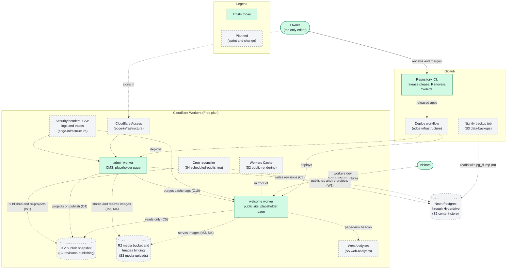
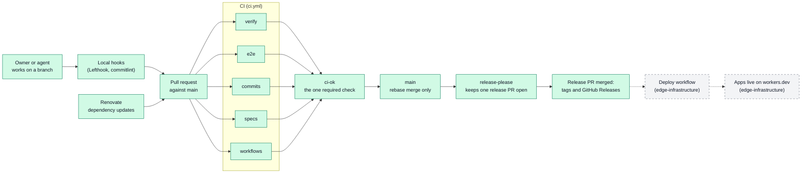

# Architecture

This document shows what `ycmcuenca-core` is made of and how the parts connect.
It covers the two workers, the shared packages, the delivery pipeline and the
parts planned through Sprint 6.

Other documents cover neighboring topics. [DECISIONS.md](DECISIONS.md) explains
why a choice was made. [ROADMAP.md](ROADMAP.md) says when a part arrives.
[PRODUCT.md](PRODUCT.md) says who the product is for.
[USER_JOURNEY.md](USER_JOURNEY.md) shows what people do with it.
[DESIGN.md](DESIGN.md) describes how it looks.

A reference such as ([C5](DECISIONS.md#cms-architecture)) points to the
decision that explains a choice. This document does not repeat the reasoning.

## How to read the diagrams

- A **solid** box or line exists in the repository today.
- A **dashed** box or line is planned. Its label names the sprint (S2 to S5) and
  the candidate change that brings it. Sprint names are tentative until the
  change is proposed; see [ROADMAP.md](ROADMAP.md).
- A part that exists in code but is not running anywhere yet is drawn solid.
  The line that connects it to its users is dashed until the part is deployed.

Status words such as `proposed` or `merged` do not appear here. They change
often, and [ROADMAP.md](ROADMAP.md) is the only place that tracks them.

## The system at a glance

### What exists today

- Two SvelteKit apps, `welcome` and `admin`, each built for Cloudflare Workers
  ([P5](DECISIONS.md#platform-and-scope)). Each serves a placeholder page.
- Neither app is deployed. They run on the owner's machine through `wrangler`,
  the Workers command-line tool. They have no storage or service bindings.
- The repository's delivery pipeline (see
  [How a change reaches users](#how-a-change-reaches-users)).

### Planned components

| Component                          | Planned in                | What it does                                                                                                                                                   | Decisions                                                                          |
| ---------------------------------- | ------------------------- | -------------------------------------------------------------------------------------------------------------------------------------------------------------- | ---------------------------------------------------------------------------------- |
| Deploy workflow and `workers.dev`  | `edge-infrastructure`     | Deploys an app when its release is created. Serves both workers on `*.ycmcuenca.workers.dev`.                                                                  | [P4, P6](DECISIONS.md#platform-and-scope)                                          |
| Cloudflare Access                  | `edge-infrastructure`     | Allows only the owner into every `admin` address. `admin` also checks the sign-in token itself.                                                                | [A1, A2](DECISIONS.md#identity-and-access)                                         |
| Security headers and CSP           | `edge-infrastructure`     | Adds browser security headers, including a Content Security Policy, to both workers.                                                                           | [I10](DECISIONS.md#integrations-and-longevity)                                     |
| Workers Logs and traces            | `edge-infrastructure`     | Records structured logs and traces from both workers, using Cloudflare's built-in tools.                                                                       | [I9](DECISIONS.md#integrations-and-longevity)                                      |
| Neon Postgres and Hyperdrive       | S2 `content-store`        | Neon is the database and the source of truth. Hyperdrive lets a worker connect to it. Two database roles keep migration rights apart from runtime rights.      | [C4](DECISIONS.md#cms-architecture), [I6](DECISIONS.md#integrations-and-longevity) |
| KV publish snapshot                | S2 `revisions-publishing` | KV is Cloudflare's key-value store. Publishing writes one key per entry (all locales) plus index keys. Every snapshot carries a version number.                | [C5, C6, C8](DECISIONS.md#cms-architecture)                                        |
| Workers Cache                      | S2 `public-rendering`     | Caches `welcome` responses, tagged by entry, type and locale. `admin` purges tags after it writes KV.                                                          | [C10](DECISIONS.md#cms-architecture)                                               |
| Cron reconciler                    | S4 `scheduled-publishing` | One scheduled job publishes entries that are due and retries snapshots that failed to write.                                                                   | [W1](DECISIONS.md#publishing-workflow)                                             |
| R2 media bucket and Images binding | S3 `media-uploads`        | R2 is Cloudflare's object storage. `admin` stores the original image and creates three web-ready widths.                                                       | [M1, M3, M4](DECISIONS.md#media)                                                   |
| Contact inbox                      | S3 `contact-inbox`        | Stores contact-form messages in the CMS, protected by Turnstile and rate limiting. The change decides which worker receives the form, so the diagram omits it. | [I1](DECISIONS.md#integrations-and-longevity)                                      |
| Nightly backup job                 | S3 `data-backups`         | A GitHub Actions job copies the database to a private R2 bucket every night and keeps 30 days.                                                                 | [I8](DECISIONS.md#integrations-and-longevity)                                      |
| Draft preview                      | S4 `draft-preview`        | Lets the owner see an unpublished entry. It runs inside `admin` and reads Neon directly.                                                                       | [W2](DECISIONS.md#publishing-workflow)                                             |
| Web Analytics                      | S5 `web-analytics`        | Counts page views with Cloudflare's privacy-preserving beacon.                                                                                                 | [I3](DECISIONS.md#integrations-and-longevity)                                      |

## How a change reaches users

Each step works like this:

1. The owner or an agent makes commits on a branch. Local hooks format and lint
   the staged files and check that each commit message follows Conventional
   Commits.
2. A pull request starts the CI jobs in `.github/workflows/ci.yml`:
   - `verify` runs format, lint, type check, build and unit tests.
   - `e2e` runs browser smoke tests.
   - `commits` checks every commit message.
   - `specs` validates the OpenSpec files and checks the living documents.
   - `workflows` lints and audits the workflow files.
3. The `ci-ok` job passes only when every other job passes. The `main` ruleset
   requires exactly that check and allows only rebase merges.
4. After each merge, `.github/workflows/release-please.yml` updates one release
   pull request. It proposes a new version for each app that changed. Merging
   that pull request creates the tags and GitHub Releases.
5. Planned: a deploy workflow reads which apps were released and deploys them
   to Cloudflare ([P6](DECISIONS.md#platform-and-scope)).

Three more parts run beside this flow. CodeQL scans the code. A committed script,
`scripts/github/apply-settings.sh`, sets the repository settings and the
`main` ruleset from files in the repository. Renovate proposes dependency
updates as pull requests that follow the same path.

## Workspace layout

The repository is a Bun and Turborepo workspace. Each planned package follows
the pattern of the existing ones: `@ycmcuenca/<name>` lives in `packages/<name>`.

| Path                             | State                          | What it holds                                                                                          |
| -------------------------------- | ------------------------------ | ------------------------------------------------------------------------------------------------------ |
| `apps/welcome`                   | Exists                         | The public portfolio worker.                                                                           |
| `apps/admin`                     | Exists                         | The CMS worker.                                                                                        |
| `packages/tsconfig`              | Exists                         | Shared TypeScript settings.                                                                            |
| `packages/eslint-config`         | Exists                         | Shared lint rules.                                                                                     |
| `openspec/`                      | Exists                         | Specs, active changes and archived changes ([P7](DECISIONS.md#platform-and-scope)).                    |
| `docs/`                          | Exists                         | The living documents and the decision log.                                                             |
| `scripts/github`, `scripts/docs` | Exist                          | The repository-settings script and the living-documents check.                                         |
| `.github/`                       | Exists                         | Workflows and the `main` ruleset.                                                                      |
| `packages/cms-core`              | Planned: S2 `content-model`    | Pure TypeScript: content types, publish rules and the ports ([C1, C2](DECISIONS.md#cms-architecture)). |
| `packages/db`                    | Planned: S2 `content-store`    | The Neon adapter and database migrations.                                                              |
| `packages/cms-render`            | Planned: S2 `public-rendering` | The Svelte blocks that `welcome` and the admin preview both use.                                       |
| `packages/ui`                    | Planned: S2 `admin-editor`     | Shared interface components ([Q2](DECISIONS.md#quality)).                                              |

Satellite projects will own their databases and connect only through published
contracts ([I7](DECISIONS.md#integrations-and-longevity)). A separate
sign-in app, `apps/auth`, waits for the first satellite that needs public
sign-ups ([A3](DECISIONS.md#identity-and-access) and the
[parking lot](DECISIONS.md#parking-lot)).

## Planned read path

This path serves a page to a visitor. `welcome` has no database binding and reads
only KV ([C5](DECISIONS.md#cms-architecture)).

1. A visitor requests a page on `welcome`.
2. Workers Cache answers if it holds the page
   ([C10](DECISIONS.md#cms-architecture)).
3. Otherwise `welcome` reads the entry's snapshot from KV. The snapshot has a
   version number, and `welcome` accepts the current and the previous version
   ([C8](DECISIONS.md#cms-architecture)).
4. `welcome` renders the page from the snapshot and the cache stores it.

## Planned write path

This path turns the owner's edit into a page. Neon is the source of truth. KV and R2
hold copies that Neon can rebuild ([C4](DECISIONS.md#cms-architecture)).

1. The owner signs in through Cloudflare Access and edits an entry in `admin`.
2. `admin` appends a new revision to Neon and never overwrites an earlier one
   ([C3](DECISIONS.md#cms-architecture)).
3. When the owner publishes, `admin` moves the entry's published pointer to a
   revision and writes the snapshot to KV ([C4](DECISIONS.md#cms-architecture)).
4. If the KV write fails, `admin` marks the entry as dirty. The cron reconciler
   retries it ([W1](DECISIONS.md#publishing-workflow)).
5. After the KV write, `admin` asks `welcome` through a service binding to purge
   the affected cache tags ([C10](DECISIONS.md#cms-architecture)).

## Keeping this document current

When a change is archived, update this document in the same branch
(`openspec/config.yaml` lists the rule). Turn the diagram elements that the
change built from dashed to solid, and keep the label of any element that is
still planned. The archive of `edge-infrastructure` is the first to do this: it
turns the deployment, Access, security headers and logging elements solid.
