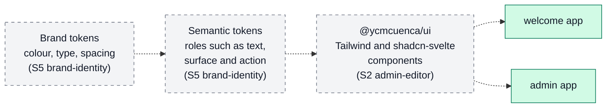

# Design

This document describes how the platform is meant to look and feel. It covers
the design principles, the accessibility target and the characters the fonts
must cover. It also covers how shared design values are layered, what the apps
look like today and which choices are still open.

Other documents cover neighboring topics. [ARCHITECTURE.md](ARCHITECTURE.md)
describes how the system is built. [PRODUCT.md](PRODUCT.md) says who the
audiences are. [USER_JOURNEY.md](USER_JOURNEY.md) shows what people do step by
step. [ROADMAP.md](ROADMAP.md) says when work happens.

The brand has not been designed yet. This document records the principles that
earlier decisions already set, an honest account of today's state, and the
choices that later sprints make. A reference such as
([Q3](DECISIONS.md#quality)) points to the decision that explains a choice.

## Principles

Each principle comes from a decision that is already made.

1. **Accessible by default.** Every page meets WCAG 2.2 level AA
   ([Q3](DECISIONS.md#quality)).
2. **Every locale renders correctly.** Fonts cover the characters of English,
   Filipino and Esperanto ([L6](DECISIONS.md#localization)).
3. **The preview matches the site.** `welcome` and the admin preview draw
   content with the same Svelte blocks, so an entry looks the same in both
   ([C1](DECISIONS.md#cms-architecture),
   [P11](DECISIONS.md#platform-and-scope)).
4. **One source for design values.** Colours, type and spacing come from shared
   design tokens, not from values repeated in each app
   ([Q2](DECISIONS.md#quality)).
5. **Light and resilient.** Pages stay within performance budgets, and the 3D
   scenes must degrade gracefully ([Q3](DECISIONS.md#quality) and the S6 exit
   criteria in [ROADMAP.md](ROADMAP.md#sprint-6-content-and-3d)).

The admin interface is in English only, for one user
([L1](DECISIONS.md#localization)).

## Accessibility target

The target is WCAG 2.2 level AA for both apps ([Q3](DECISIONS.md#quality)).
Automated accessibility checks (axe, run in the Playwright suite) and
performance budgets (Lighthouse) arrive in CI with the brand sprint, S5. Until
then, no automated check enforces the target.

## Glyph coverage

Fonts must cover every character of the three locales
([L6](DECISIONS.md#localization)):

- English needs Basic Latin.
- Filipino adds Ñ and ñ (U+00D1 and U+00F1), which are in Latin-1 Supplement.
- Esperanto adds the Latin Extended-A block (U+0100 to U+017F), for six letters
  in upper and lower case: ĉ, ĝ, ĥ, ĵ, ŝ and ŭ.

The brand sprint chooses the fonts and checks the result on a page in each
locale.

## How design values are layered

Shared design values reach the apps in layers. Tailwind and shadcn-svelte
components arrive first, in `@ycmcuenca/ui`, with the first admin screens in S2.
Brand tokens arrive later, in S5, and the components pick them up
([Q2](DECISIONS.md#quality)).

A solid box exists today. A dashed box is planned. The split between brand
tokens and semantic tokens is a proposal. The brand sprint confirms or changes
it.

## Current visual state

Checked on 2026-10-18 with `bun run dev`. `welcome` runs on
<http://localhost:5173> and `admin` on <http://localhost:5174>.

- Each app shows one heading, "Welcome" or "Admin", and nothing else.
- The heading uses the browser's default serif typeface in black on a white
  background, with the browser's default margins.
- There is no layout, navigation, colour, custom font, logo or dark theme.
- The pages have no title, so the browser tab shows only the address.
- Both browser tabs show SvelteKit's default favicon, the Svelte logo.

The apps carry no styles of their own, so they follow the browser's defaults. No
automated accessibility check exists yet.

## Open design choices

| Choice                                                          | Decided in           |
| --------------------------------------------------------------- | -------------------- |
| Layout and look of the admin editor                             | S2 `admin-editor`    |
| Brand identity: colour palette, logo and favicon                | S5 `brand-identity`  |
| Typefaces that cover Latin Extended-A                           | S5 `brand-identity`  |
| Token names, and the split between brand and semantic tokens    | S5 `brand-identity`  |
| Whether to offer more than one colour theme                     | S5 `brand-identity`  |
| Layout, navigation and page templates of the public site        | S5 `welcome-design`  |
| Accessibility and performance budgets, and how CI enforces them | S5 `quality-budgets` |
| Look and fallback of the 3D scenes                              | S6 `threlte-scenes`  |

Sprint numbers come from [ROADMAP.md](ROADMAP.md). Change names are candidates
until each change is proposed.
