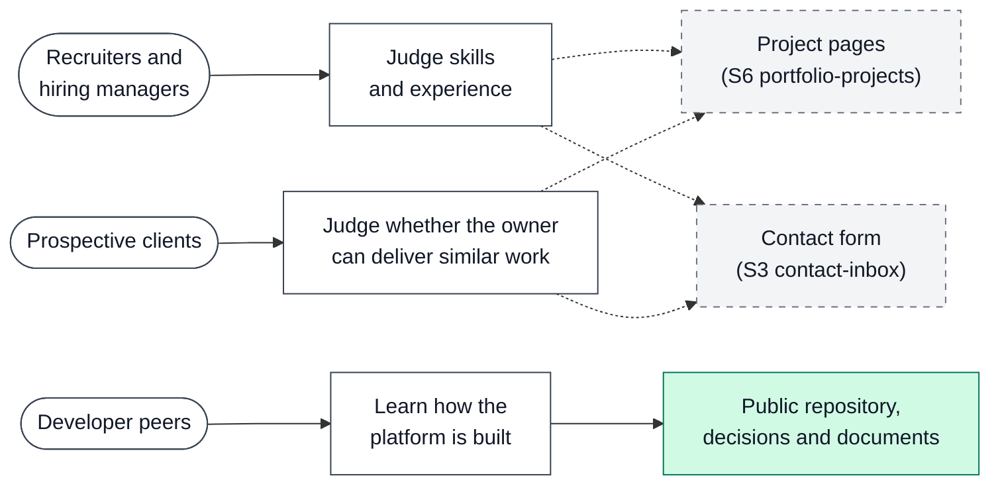

# Product

This document says what `ycmcuenca-core` is for, who it serves, what it aims to
do and what it leaves out.

Other documents cover neighboring topics. [ARCHITECTURE.md](ARCHITECTURE.md)
describes how the system is built. [USER_JOURNEY.md](USER_JOURNEY.md) shows what
each person does, step by step. [DESIGN.md](DESIGN.md) describes how it looks.
[ROADMAP.md](ROADMAP.md) says when each part arrives.

This document states intent. The roadmap is the plan of record. Where the two
differ, follow the roadmap.

A reference such as ([A1](DECISIONS.md#identity-and-access)) points to the
decision in [DECISIONS.md](DECISIONS.md) that explains a choice.

## Purpose

`ycmcuenca-core` is the personal platform of Yosef Christian Mercene Cuenca, the
owner. It has three jobs:

1. **Show the owner's work.** A public portfolio site, `welcome`, presents the
   owner's projects and skills.
2. **Run the owner's content.** A content management system (CMS), `admin`, lets
   the owner write and publish that content.
3. **Be a base.** Future side projects, called satellites, build on the same
   platform ([I7](DECISIONS.md#integrations-and-longevity)).

The owner builds the CMS by hand on purpose, to learn how such a system works.
Everything else uses managed services ([P1](DECISIONS.md#platform-and-scope)).

Today both apps show a placeholder page and nothing is deployed.

## Who it is for

The public site has three audiences. Each comes with a different question.

| Audience                       | What they come to do                                                         | What they need to find                                        |
| ------------------------------ | ---------------------------------------------------------------------------- | ------------------------------------------------------------- |
| Recruiters and hiring managers | Judge the owner's skills and experience, and decide whether to get in touch. | The owner's projects, and a way to make contact.              |
| Prospective clients            | Decide whether the owner can deliver work like theirs, and ask about it.     | Past projects and a way to make contact.                      |
| Developer peers                | See how the platform is built and learn from it.                             | The public repository, the decisions and the documents in it. |

The repository is public on purpose, so peers can read how the platform was
built ([P2](DECISIONS.md#platform-and-scope)).

In the diagram, a solid box exists today and a dashed box is planned. The
white boxes are people and their goals. The site itself is planned, so the lines
from goals to site areas are dashed. The repository is already public, so that
line is solid.

## The only editor

The owner is the only person who writes content. `admin` sits behind Cloudflare
Access, and only the owner can sign in
([A1](DECISIONS.md#identity-and-access)). The platform has no editor roles and
no accounts for other people.

## Goals

- Present the owner's work to the three audiences above, in three languages.
- Let the owner write, preview and publish content without touching code.
- Keep the platform small enough for one person to maintain over many years
  ([P10](DECISIONS.md#platform-and-scope)).
- Stay within the Cloudflare Workers Free plan
  ([P3](DECISIONS.md#platform-and-scope)).
- Serve as the base for future satellites.

## Non-goals

The core platform does not aim to:

- **Support several editors.** There is one editor
  ([A1](DECISIONS.md#identity-and-access)).
- **Offer public sign-ups.** A separate sign-in app waits for the first
  satellite that needs one ([A3](DECISIONS.md#identity-and-access)).
- **Translate the admin interface.** It stays in English
  ([L1](DECISIONS.md#localization)).
- **Set traffic or conversion targets.** Page views become visible in S5 with
  Cloudflare Web Analytics ([I3](DECISIONS.md#integrations-and-longevity)).

## Languages

The public site has three locales: English (`en`), Filipino (`fil`) and
Esperanto (`eo`) ([L1](DECISIONS.md#localization)). English comes first. An
entry cannot be published until its English text is ready. If an entry is not
ready in another locale, that locale does not show it
([L3](DECISIONS.md#localization)).

## How we measure success

Success means meeting each sprint's exit criteria in [ROADMAP.md](ROADMAP.md).
This document does not copy them.

| Sprint                                                                                             | Success in one line                                                 |
| -------------------------------------------------------------------------------------------------- | ------------------------------------------------------------------- |
| [S1 Foundation](ROADMAP.md#sprint-1-foundation)                                                    | Both workers run on the internet, and `admin` is private.           |
| [S2 Publish path](ROADMAP.md#sprint-2-publish-path)                                                | The owner publishes an English entry and `welcome` shows it.        |
| [S3 Media, inbox and backups](ROADMAP.md#sprint-3-media-inbox-and-backups)                         | Entries carry images, visitors can write, and data can be restored. |
| [S4 Scheduling, preview and localization](ROADMAP.md#sprint-4-scheduling-preview-and-localization) | The owner can schedule, preview and publish in three languages.     |
| [S5 Brand](ROADMAP.md#sprint-5-brand)                                                              | Both apps carry the owner's brand, and quality is measured.         |
| [S6 Content and 3D](ROADMAP.md#sprint-6-content-and-3d)                                            | The portfolio holds real projects and has its 3D layer.             |

The roadmap sets no traffic or conversion targets. Until Web Analytics arrives
in S5, success is judged by the exit criteria alone.
