# Roadmap

The plan for `ycmcuenca-core`, sprint by sprint. Sprints are the plan; each
app's version follows from what ships in them (see
[How versions relate to sprints](#how-versions-relate-to-sprints)).

This file and [DECISIONS.md](DECISIONS.md) carry the planning context between
sessions. Read both before proposing an OpenSpec change, and update the
change's row here when it moves to a new status.

The other living documents are [ARCHITECTURE.md](ARCHITECTURE.md),
[DESIGN.md](DESIGN.md), [PRODUCT.md](PRODUCT.md),
[SYSTEM_DESIGN.md](SYSTEM_DESIGN.md) and [USER_JOURNEY.md](USER_JOURNEY.md).

- **Pace:** 8–12 hours a week, mostly agent-driven work with human review. A
  sprint takes one to two weeks, so this roadmap has no dates.
- **Unit of work:** one OpenSpec change is one capability, one pull request.
- **Change names** describe the capability (`ci-release-pipeline`), never the
  sprint. Names for future sprints are candidates and are fixed only when the
  change is proposed.

## Status vocabulary

| Status        | Meaning                                                                 |
| ------------- | ----------------------------------------------------------------------- |
| `planned`     | Listed here, no OpenSpec change yet.                                    |
| `proposed`    | Change exists in `openspec/changes/` with its artifacts, not yet built. |
| `in progress` | Being implemented, or its PR is open.                                   |
| `merged`      | The implementation PR is on `main`; follow-ups or the archive pending.  |
| `archived`    | Archived in `openspec/changes/archive/`, specs synced.                  |

## Overview

Solid boxes have an OpenSpec change; dashed boxes are planned. Arrows point from
a change to the changes that build on it.

```mermaid
flowchart LR
    subgraph S1["S1 Foundation"]
        bootstrap["bootstrap-monorepo"]:::archived
        ci["ci-release-pipeline"]:::archived
        edge["edge-infrastructure"]:::archived
        docs["living-docs"]:::archived
        notebook["system-design-notebook"]:::archived
    end
    subgraph S2["S2 Publish path"]
        s2["content-model, content-store,<br/>revisions-publishing, public-rendering,<br/>admin-editor, edge-cache"]:::proposed
    end
    subgraph S3["S3 Media, inbox, backups"]
        s3["media uploads, contact inbox,<br/>data backups"]:::planned
    end
    subgraph S4["S4 Workflow"]
        s4["scheduled publishing,<br/>draft preview, localization"]:::planned
    end
    subgraph S5["S5 Brand"]
        s5["brand identity, welcome design,<br/>analytics, a11y + perf budgets"]:::planned
    end
    subgraph S6["S6 Content + 3D"]
        s6["projects content,<br/>Threlte 3D"]:::planned
    end

    bootstrap --> ci --> edge
    bootstrap --> docs --> notebook
    edge --> s2 --> s3 --> s4 --> s5 --> s6

    classDef archived fill:#d1fae5,stroke:#047857,color:#111827
    classDef merged fill:#dbeafe,stroke:#1d4ed8,color:#111827
    classDef inProgress fill:#fef3c7,stroke:#b45309,color:#111827
    classDef proposed fill:#ede9fe,stroke:#6d28d9,color:#111827
    classDef planned fill:#f3f4f6,stroke:#6b7280,color:#111827,stroke-dasharray:5 5
```

## Sprint 1: Foundation

**Goal:** a gated, hardened repository whose two workers are live on
`*.ycmcuenca.workers.dev`, with the living documents in place.

| Change                   | Status   | What it delivers                                                                                                                                                                                                                                                                                                                                                                                                                                                                       |
| ------------------------ | -------- | -------------------------------------------------------------------------------------------------------------------------------------------------------------------------------------------------------------------------------------------------------------------------------------------------------------------------------------------------------------------------------------------------------------------------------------------------------------------------------------- |
| `bootstrap-monorepo`     | archived | Bun + Turborepo workspace, `welcome` and `admin` as hello-world SvelteKit apps on the Workers adapter (local only), ESLint, Prettier, Lefthook + commitlint, Vitest, Chromium smoke tests on `wrangler dev`. PR #1, archived 2026-10-17.                                                                                                                                                                                                                                               |
| `ci-release-pipeline`    | archived | PR CI with one `ci-ok` gate, release-please (one version per app), repository settings as code, SHA-pinned actions, Renovate, CodeQL. PR #2 merged, follow-up PR #5 merged, archived 2026-10-18.                                                                                                                                                                                                                                                                                       |
| `edge-infrastructure`    | archived | Cloudflare API token, a deploy workflow that consumes release-please's `paths_released`, both workers live on `workers.dev`, Cloudflare Access in front of `admin` (production and preview URLs), Workers Logs and traces (I9), security headers and CSP (I10). KV, R2 and Neon are created in S2 and S3 by the change that first uses them. PR #9 merged, release PR #10 deployed 0.1.0, follow-up PR #11 merged, archived 2026-10-18.                                                |
| `living-docs`            | archived | Adopts this file and DECISIONS.md and adds ARCHITECTURE, DESIGN, PRODUCT and USER_JOURNEY, each with a Mermaid diagram, plus AGENTS.md, a README documentation index and a CI check that the documents exist. Revises the master architecture diagram: solid lines for what exists, dashed for what is planned. PR #8, archived 2026-10-18.                                                                                                                                            |
| `system-design-notebook` | archived | Adds SYSTEM_DESIGN.md, a sixth living document: a study notebook of the system design concepts each sprint applies, with full S1 entries, planned stubs for S2 to S6 and dated references. Links it from ROADMAP, ARCHITECTURE and DECISIONS, and extends the living-documents check to entry structure and relative links. Added to S1 after the sprint's other changes were archived. PR #13, archived 2026-10-18. The 13 Sprint 1 lessons are drafts until the owner rewrites them. |

**Exit criteria:** `main` changes only through checked PRs; a merged release
PR deploys the released app; `admin` is reachable only through Access; all six
living documents exist.

**Learning concepts:**
[monorepo task graphs and caching](SYSTEM_DESIGN.md#monorepo-task-graphs-and-caching),
[trunk-based development with a required-check gate](SYSTEM_DESIGN.md#trunk-based-development-with-a-required-check-gate),
[release trains from Conventional Commits](SYSTEM_DESIGN.md#release-trains-from-conventional-commits),
[settings as code](SYSTEM_DESIGN.md#settings-as-code),
[supply-chain hardening](SYSTEM_DESIGN.md#supply-chain-hardening),
[reproducible toolchains](SYSTEM_DESIGN.md#reproducible-toolchains),
[least privilege](SYSTEM_DESIGN.md#least-privilege),
[zero trust and defense in depth](SYSTEM_DESIGN.md#zero-trust-and-defense-in-depth),
[browser security headers and CSP](SYSTEM_DESIGN.md#browser-security-headers-and-csp),
[testing the production artifact](SYSTEM_DESIGN.md#testing-the-production-artifact),
[structured logs with a correlation id](SYSTEM_DESIGN.md#structured-logs-with-a-correlation-id),
[fitness functions](SYSTEM_DESIGN.md#fitness-functions)
and [documentation as a bounded context](SYSTEM_DESIGN.md#documentation-as-a-bounded-context).

## Sprint 2: Publish path

**Goal:** a walking skeleton. The owner writes and publishes an English entry in
`admin`, and `welcome` serves it from a published snapshot.

The changes are built in this order, each on the one before it (owner
decision). `edge-cache` was split out of `public-rendering`, because caching
needs a hand-written entry around SvelteKit's worker.

| Change                 | Status   | What it delivers                                                                                                                                                                                                                                             |
| ---------------------- | -------- | ------------------------------------------------------------------------------------------------------------------------------------------------------------------------------------------------------------------------------------------------------------ |
| `content-model`        | proposed | `@ycmcuenca/cms-core`: field, block and type layers (C2), the English-only `article` type with a block-list body, validation with field errors, safe Markdown rendering with a 32 KB limit (C9), the versioned snapshot contract (C8) and form descriptions. |
| `content-store`        | proposed | `@ycmcuenca/db` on Drizzle 0.45.4 (Q5), append-only revisions enforced by privileges, two roles (I6), migrations in the deploy, Hyperdrive with caching disabled, a local Postgres 18 container, and Neon branches in a separate CI project (Q1, amended).   |
| `revisions-publishing` | proposed | Publish, unpublish and roll back as pointer moves, the KV projector with an index rebuilt from Neon (C4 to C6), automatic publish times, and a visible dirty state with a manual retry until W1.                                                             |
| `public-rendering`     | proposed | `@ycmcuenca/cms-render`, `welcome` reading KV only (C5) at `/en/articles/{slug}` with an article list, a tolerant reader, SEO basics (Q4), and a two-worker end-to-end test of the publish path.                                                             |
| `admin-editor`         | proposed | `@ycmcuenca/ui` with Tailwind and shadcn-svelte (Q2), the entry list, forms generated from the type definition, a textarea editor with a server-rendered preview, and the first production publish.                                                          |
| `edge-cache`           | proposed | Workers Cache in front of `welcome` through a wrapper entry with a cached `Site` entrypoint, slug-based cache tags, purge over a service binding after every projection (C10), and a 60-second edge lifetime with stale-while-revalidate.                    |

**Exit criteria:** publishing an English entry makes it visible on `welcome`
with no database binding on `welcome`; editing creates a new revision and never
overwrites one; a publish purges exactly the affected cached pages.

**Learning concepts:**
[hexagonal architecture (ports and adapters)](SYSTEM_DESIGN.md#hexagonal-architecture-ports-and-adapters),
[CQRS-lite read projections](SYSTEM_DESIGN.md#cqrs-lite-read-projections),
[event-sourcing-lite append-only revisions](SYSTEM_DESIGN.md#event-sourcing-lite-append-only-revisions),
[schema versioning with upcasters](SYSTEM_DESIGN.md#schema-versioning-with-upcasters),
[versioned contracts and tolerant readers](SYSTEM_DESIGN.md#versioned-contracts-and-tolerant-readers),
[cache invalidation by tag](SYSTEM_DESIGN.md#cache-invalidation-by-tag)
and [branch-per-PR database testing](SYSTEM_DESIGN.md#branch-per-pr-database-testing).

## Sprint 3: Media, inbox and backups

**Goal:** entries can carry images, visitors can send a message, and the data
survives a mistake.

Candidate changes (tentative names):

- `media-uploads`: single-part uploads to R2 through the three-step protocol
  (M3), derivatives from the Images binding (M4), BlurHash in the browser.
- `contact-inbox`: the contact form into the CMS inbox, with Turnstile and rate
  limiting (I1).
- `data-backups`: `cms export` (I5) and the nightly backup job to private R2
  with a restore drill (I8).

**Exit criteria:** an uploaded image is served at its three widths; a contact
message appears in the inbox and spam is rejected; a backup restores into a
Neon branch with matching row counts.

**Learning concepts:**
[content-addressed storage](SYSTEM_DESIGN.md#content-addressed-storage),
[upload protocols and integrity checks](SYSTEM_DESIGN.md#upload-protocols-and-integrity-checks),
[abuse prevention](SYSTEM_DESIGN.md#abuse-prevention)
and [backup and restore as a tested process](SYSTEM_DESIGN.md#backup-and-restore-as-a-tested-process) (RPO and RTO).

## Sprint 4: Scheduling, preview and localization

**Goal:** the owner can schedule a publish, preview a draft, and publish in
English, Filipino and Esperanto.

Candidate changes (tentative names): `scheduled-publishing` (cron reconciler
with an atomic claim, W1), `draft-preview` (owner-only preview in `admin`,
reading Neon, W2), `content-localization` (per-field localization, per-locale
`ready` flags, Paraglide for UI strings, `/{locale}/{type}/{slug}` URLs).

**Exit criteria:** a scheduled entry publishes within the reconciler's window;
a draft is visible only through `admin`; an untranslated entry is hidden in
that locale and English must be ready before any publish.

**Learning concepts:**
[reconciliation loops and at-most-once claims](SYSTEM_DESIGN.md#reconciliation-loops-and-at-most-once-claims),
[eventual consistency and its SLOs](SYSTEM_DESIGN.md#eventual-consistency-and-its-slos),
[time handling in UTC](SYSTEM_DESIGN.md#time-handling-in-utc),
[internationalization versus localization](SYSTEM_DESIGN.md#internationalization-versus-localization)
and [read-your-writes for previews](SYSTEM_DESIGN.md#read-your-writes-for-previews).

## Sprint 5: Brand

**Goal:** both apps carry the owner's brand, and quality is measured.

Candidate changes (tentative names): `brand-identity` (tokens, type and colour
on top of `@ycmcuenca/ui`, fonts covering Latin Extended-A), `welcome-design`
(the public site's visual design), `web-analytics` (Cloudflare Web Analytics
beacon), `quality-budgets` (axe accessibility checks and Lighthouse budgets in
CI, Q3).

**Exit criteria:** every page uses the shared design tokens; all three locales
render with correct glyphs; accessibility and performance budgets pass in CI;
page views are visible in Web Analytics.

**Learning concepts:**
[design tokens and theming](SYSTEM_DESIGN.md#design-tokens-and-theming),
[accessibility as a requirement](SYSTEM_DESIGN.md#accessibility-as-a-requirement),
[font subsetting and loading](SYSTEM_DESIGN.md#font-subsetting-and-loading),
[performance budgets](SYSTEM_DESIGN.md#performance-budgets)
and [privacy-preserving analytics](SYSTEM_DESIGN.md#privacy-preserving-analytics).

## Sprint 6: Content and 3D

**Goal:** the portfolio is filled with real content and has its 3D layer.

Candidate changes (tentative names): `portfolio-projects` (projects as a CMS
content type and the pages that list them), `threlte-scenes` (Threlte 3D on
`welcome`).

**Exit criteria:** the portfolio's projects are authored in the CMS and
published in English at least; the 3D scenes stay within the Workers Free
limits and degrade gracefully.

**Learning concepts:**
[content modelling against real content](SYSTEM_DESIGN.md#content-modelling-against-real-content),
[progressive enhancement](SYSTEM_DESIGN.md#progressive-enhancement)
and [performance budgets for 3D on the web](SYSTEM_DESIGN.md#performance-budgets-for-3d-on-the-web).

## After Sprint 6

Deferred work, each with the trigger that brings it in, is listed in the
parking lot of [DECISIONS.md](DECISIONS.md#parking-lot): the Workers Paid
plan, the custom domain and email, multipart uploads, `apps/auth`, OpenAPI,
the metrics dashboard and versioned internal packages.

## Recurring checks

- **Monthly:** compare usage in the Cloudflare dashboard with the Free limits
  (P3). Any limit at 70% or more for 3 days triggers the Workers Paid review.
- **Quarterly:** run the backup restore drill (I8).
- **Quarterly:** open every external link in
  [SYSTEM_DESIGN.md](SYSTEM_DESIGN.md) by hand, replace dead ones and update
  the dates of the sources you re-read.

## How versions relate to sprints

Each deployable app (`welcome`, `admin`) has its own semantic version, derived
by release-please from the Conventional Commits that touch it. A sprint does
not produce a version number; it produces the commits that the next release PR
turns into one. Apps stay below 1.0.0 until the owner declares the platform
stable.
