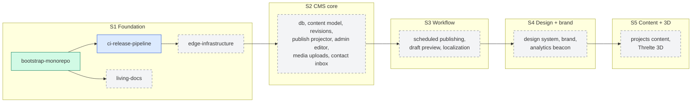

# Roadmap

The plan for `ycmcuenca-core`, sprint by sprint. Sprints are the plan; each
app's version follows from what ships in them (see
[How versions relate to sprints](#how-versions-relate-to-sprints)).

This file and [DECISIONS.md](DECISIONS.md) carry the planning context between
sessions. Read both before proposing an OpenSpec change, and update the
change's row here when it moves to a new status.

- **Pace:** 8–12 hours a week, mostly agent-driven work with human review. A
  sprint takes one to two weeks, so this roadmap has no dates.
- **Unit of work:** one OpenSpec change is one capability, one pull request.
- **Change names** describe the capability (`ci-release-pipeline`), never the
  sprint. Names for future sprints are candidates and are fixed only when the
  change is proposed.

## Status vocabulary

| Status        | Meaning                                                                 |
| ------------- | ----------------------------------------------------------------------- |
| `planned`     | Listed here, no OpenSpec change yet.                                    |
| `proposed`    | Change exists in `openspec/changes/` with its artifacts, not yet built. |
| `in progress` | Being implemented, or its PR is open.                                   |
| `merged`      | The implementation PR is on `main`; follow-ups or the archive pending.  |
| `archived`    | Archived in `openspec/changes/archive/`, specs synced.                  |

## Overview

Solid boxes exist or are under way; dashed boxes are planned. Arrows point from
a change to the changes that build on it.

## Sprint 1: Foundation

**Goal:** a gated, hardened repository whose two workers are live on
`*.ycmcuenca.workers.dev`, with the living documents in place.

| Change                | Status   | What it delivers                                                                                                                                                                                                                                                        |
| --------------------- | -------- | ----------------------------------------------------------------------------------------------------------------------------------------------------------------------------------------------------------------------------------------------------------------------- |
| `bootstrap-monorepo`  | archived | Bun + Turborepo workspace, `welcome` and `admin` as hello-world SvelteKit apps on the Workers adapter (local only), ESLint, Prettier, Lefthook + commitlint, Vitest, Chromium smoke tests on `wrangler dev`. PR #1, archived 2026-10-17.                                |
| `ci-release-pipeline` | merged   | PR CI with one `ci-ok` gate, release-please (one version per app), repository settings as code, SHA-pinned actions, Renovate, CodeQL. PR #2 merged; follow-up PR #5 open; archive pending.                                                                              |
| `edge-infrastructure` | planned  | Cloudflare API token, a deploy workflow that consumes release-please's `paths_released`, both workers live on `workers.dev`, Cloudflare Access in front of `admin` (production and preview URLs). KV, R2 and Neon are created in S2 by the change that first uses them. |
| `living-docs`         | planned  | Adopts this file and DECISIONS.md and adds ARCHITECTURE, DESIGN, PRODUCT and USER_JOURNEY, each with a Mermaid diagram. Revises the master architecture diagram: solid lines for what exists, dashed for what is planned.                                               |

**Exit criteria:** `main` changes only through checked PRs; a merged release
PR deploys the released app; `admin` is reachable only through Access; all five
living documents exist.

**Learning concepts:** monorepo task graphs and caching, trunk-based
development with a required-check gate, release trains from Conventional
Commits, settings as code (desired state plus an idempotent reconciler),
supply-chain hardening (SHA pinning, least privilege, workflow auditing),
zero-trust access at the edge.

## Sprint 2: CMS core

**Goal:** the owner can write, revise and publish an entry in `admin`, and
`welcome` serves it from a published snapshot.

Candidate changes (tentative names): `content-store` (Neon, Hyperdrive, Drizzle
in `@ycmcuenca/db`), `content-model` (code-first field, block and type layers
in `@ycmcuenca/cms-core`), `revisions-publishing` (append-only revisions,
pointer moves, the KV publish projector), `public-rendering` (`welcome` reads
KV through `@ycmcuenca/cms-render`), `admin-editor` (forms and Markdown
editor), `media-uploads` (single-part uploads to R2 through the three-step
protocol), `contact-inbox` (contact form into the CMS inbox).

**Exit criteria:** publishing an English entry makes it visible on `welcome`
with no database binding on `welcome`; editing creates a new revision and never
overwrites one; a single image upload produces its WebP widths.

**Learning concepts:** hexagonal architecture (ports and adapters), CQRS-lite
read projections, event-sourcing-lite append-only revisions, schema versioning
with upcasters, content-addressed storage, idempotent projection and retries.

## Sprint 3: Scheduling, preview and localization

**Goal:** the owner can schedule a publish, preview a draft, and publish in
English, Filipino and Esperanto.

Candidate changes (tentative names): `scheduled-publishing` (cron reconciler
with an atomic claim), `draft-preview` (owner-only preview in `admin`, reading
Neon), `content-localization` (per-field localization, per-locale `ready`
flags, Paraglide for UI strings, `/{locale}/{type}/{slug}` URLs).

**Exit criteria:** a scheduled entry publishes within the reconciler's window;
a draft is visible only through `admin`; an untranslated entry is hidden in
that locale and English must be ready before any publish.

**Learning concepts:** reconciliation loops and at-most-once claims,
eventual consistency and its SLOs, time handling in UTC, internationalization
versus localization, read-your-writes for previews.

## Sprint 4: Design and brand

**Goal:** both apps share a designed, branded UI.

Candidate changes (tentative names): `design-system` (Tailwind, shadcn,
`@ycmcuenca/ui`), `brand-identity` (type, colour, fonts covering Latin
Extended-A for Esperanto), `web-analytics` (Cloudflare Web Analytics beacon).

**Exit criteria:** every page uses the shared design tokens and components;
all three locales render with correct glyphs; page views are visible in Web
Analytics.

**Learning concepts:** design tokens and theming, component libraries as a
shared package, accessibility as a requirement, font subsetting and loading,
privacy-preserving analytics.

## Sprint 5: Content and 3D

**Goal:** the portfolio is filled with real content and has its 3D layer.

Candidate changes (tentative names): `portfolio-projects` (projects as a CMS
content type and the pages that list them), `threlte-scenes` (Threlte 3D on
`welcome`).

**Exit criteria:** the portfolio's projects are authored in the CMS and
published in English at least; the 3D scenes stay within the Workers Free
limits and degrade gracefully.

**Learning concepts:** content modelling against real content, progressive
enhancement, performance budgets for 3D on the web.

## After Sprint 5

Deferred work, each with the trigger that brings it in, is listed in the
parking lot of [DECISIONS.md](DECISIONS.md#parking-lot): the custom domain and
email, multipart uploads, `apps/auth`, OpenAPI, the metrics dashboard and
versioned internal packages.

## How versions relate to sprints

Each deployable app (`welcome`, `admin`) has its own semantic version, derived
by release-please from the Conventional Commits that touch it. A sprint does
not produce a version number; it produces the commits that the next release PR
turns into one. Apps stay below 1.0.0 until the owner declares the platform
stable.
