# System design

This document is a study notebook. It explains the system design concepts that
`ycmcuenca-core` applies, sprint by sprint: what each concept is, the problem
it solves, where this repository applies it and what to read to learn more. It
is written for a web developer who knows HTTP, TypeScript and git but is new to
system design.

This is not the document about how the apps look. [DESIGN.md](DESIGN.md) covers
visual and user-experience design. This notebook covers system design concepts.

Other documents cover neighboring topics, and this notebook links to them
instead of repeating them. [DECISIONS.md](DECISIONS.md) records what was
decided. [ARCHITECTURE.md](ARCHITECTURE.md) shows what exists and how the parts
connect. [ROADMAP.md](ROADMAP.md) says when each concept is built.
[PRODUCT.md](PRODUCT.md) says who the platform is for, and
[USER_JOURNEY.md](USER_JOURNEY.md) shows what people do with it.

A reference such as ([C5](DECISIONS.md#cms-architecture)) points to a decision.
A reference such as `ci D9` points to decision D9 in an archived change's
`design.md`, which records the detailed reasoning.

## Contents

- [How to read an entry](#how-to-read-an-entry)
- [Overview](#overview)
- [Sprint 1: Foundation](#sprint-1-foundation)
  - [Monorepo task graphs and caching](#monorepo-task-graphs-and-caching)
  - [Trunk-based development with a required-check gate](#trunk-based-development-with-a-required-check-gate)
  - [Release trains from Conventional Commits](#release-trains-from-conventional-commits)
  - [Settings as code](#settings-as-code)
  - [Supply-chain hardening](#supply-chain-hardening)
  - [Reproducible toolchains](#reproducible-toolchains)
  - [Least privilege](#least-privilege)
  - [Zero trust and defense in depth](#zero-trust-and-defense-in-depth)
  - [Browser security headers and CSP](#browser-security-headers-and-csp)
  - [Testing the production artifact](#testing-the-production-artifact)
  - [Structured logs with a correlation id](#structured-logs-with-a-correlation-id)
  - [Fitness functions](#fitness-functions)
  - [Documentation as a bounded context](#documentation-as-a-bounded-context)
- [Sprint 2: Publish path](#sprint-2-publish-path)
  - [Hexagonal architecture (ports and adapters)](#hexagonal-architecture-ports-and-adapters)
  - [CQRS-lite read projections](#cqrs-lite-read-projections)
  - [Event-sourcing-lite append-only revisions](#event-sourcing-lite-append-only-revisions)
  - [Schema versioning with upcasters](#schema-versioning-with-upcasters)
  - [Versioned contracts and tolerant readers](#versioned-contracts-and-tolerant-readers)
  - [Cache invalidation by tag](#cache-invalidation-by-tag)
  - [Branch-per-PR database testing](#branch-per-pr-database-testing)
- [Sprint 3: Media, inbox and backups](#sprint-3-media-inbox-and-backups)
  - [Content-addressed storage](#content-addressed-storage)
  - [Upload protocols and integrity checks](#upload-protocols-and-integrity-checks)
  - [Abuse prevention](#abuse-prevention)
  - [Backup and restore as a tested process](#backup-and-restore-as-a-tested-process)
- [Sprint 4: Scheduling, preview and localization](#sprint-4-scheduling-preview-and-localization)
  - [Reconciliation loops and at-most-once claims](#reconciliation-loops-and-at-most-once-claims)
  - [Eventual consistency and its SLOs](#eventual-consistency-and-its-slos)
  - [Time handling in UTC](#time-handling-in-utc)
  - [Internationalization versus localization](#internationalization-versus-localization)
  - [Read-your-writes for previews](#read-your-writes-for-previews)
- [Sprint 5: Brand](#sprint-5-brand)
  - [Design tokens and theming](#design-tokens-and-theming)
  - [Accessibility as a requirement](#accessibility-as-a-requirement)
  - [Font subsetting and loading](#font-subsetting-and-loading)
  - [Performance budgets](#performance-budgets)
  - [Privacy-preserving analytics](#privacy-preserving-analytics)
- [Sprint 6: Content and 3D](#sprint-6-content-and-3d)
  - [Content modelling against real content](#content-modelling-against-real-content)
  - [Progressive enhancement](#progressive-enhancement)
  - [Performance budgets for 3D on the web](#performance-budgets-for-3d-on-the-web)
- [Keeping this document current](#keeping-this-document-current)

## How to read an entry

Each concept has one entry, under the sprint that first applies it. A later
sprint that uses the concept again links back to that entry.

The line under each heading gives the entry's status:

- **built (S1)** means the change that applies the concept is archived. A built
  entry has every part listed below.
- **planned (S2)** means the concept is not built yet. A planned entry is a
  stub for studying ahead: a definition, questions and reading. It says nothing
  about an implementation, because none exists.

A built entry has these parts, always in this order:

1. **What it is:** the concept and the problem it solves, in general terms.
2. **A diagram** that shows the idea.
3. **Trade-offs:** what the concept costs and when it is the wrong choice.
4. **How this repository applies it:** links to the decisions, the archived
   design decisions and the code. Each link has at most one sentence of
   context. The linked source holds the reasoning.
5. **What we learned here:** only what building this repository revealed, such
   as a surprise, a mistake or a platform limit.
6. **Check yourself:** two to four questions. Each answer is hidden until you
   open it, so you can test your memory first.
7. **Further reading:** two to five trusted sources, each with the date it was
   last read.

Code is cited by file path only, never by line number, because line numbers go
stale.

## Overview

Each box is one concept, grouped by the sprint that first applies it. A solid
box is built. A dashed box is planned.

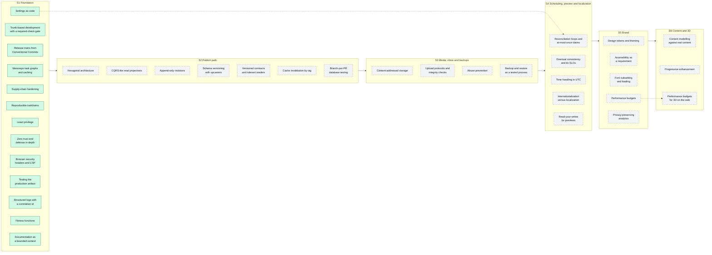

The two dotted links show a later concept that builds on an earlier one.

## Sprint 1: Foundation

**Study path:** Sprint 1 is built, so study it after the fact, in this order.
Start with how code moves: [monorepo task graphs](#monorepo-task-graphs-and-caching),
then [trunk-based development](#trunk-based-development-with-a-required-check-gate)
and [release trains](#release-trains-from-conventional-commits). Then study how
the repository governs itself: [settings as code](#settings-as-code),
[supply-chain hardening](#supply-chain-hardening),
[reproducible toolchains](#reproducible-toolchains) and
[least privilege](#least-privilege). Then the deployed edge:
[zero trust](#zero-trust-and-defense-in-depth),
[security headers](#browser-security-headers-and-csp),
[testing the production artifact](#testing-the-production-artifact) and
[structured logs](#structured-logs-with-a-correlation-id). Finish with the two
documentation concepts, [fitness functions](#fitness-functions) and
[documentation as a bounded context](#documentation-as-a-bounded-context).
Before Sprint 2, re-read settings as code: Sprint 4's reconciler builds on it.

### Monorepo task graphs and caching

**Status:** built (S1)

**What it is**

A monorepo is one repository that holds several projects, here two apps and
their shared packages. Its main benefit is that a change across projects lands
as one commit. Its main cost is that running every check on every project gets
slow as the repository grows.

A task graph fixes most of that cost. A task is one command for one project,
such as "build `admin`". The graph records which tasks depend on which, so a
tool can run independent tasks in parallel and dependent ones in order.

Caching removes most of the rest. A content-addressed cache stores a task's
output under a hash of its inputs. A hash is a short fingerprint computed from
data: the same inputs always give the same hash. If nothing a task reads has
changed, the tool replays the stored output instead of running the task.

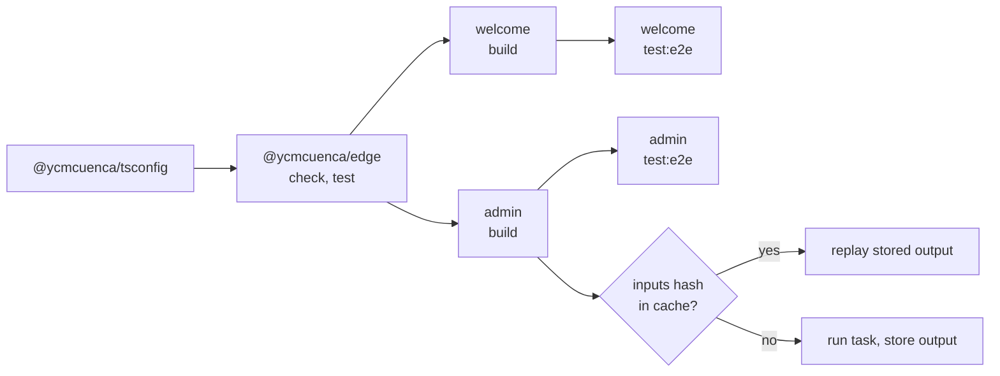

**Trade-offs**

- Shared code changes in one commit, but every project moves at the pace of
  the shared lockfile and tools.
- The cache is only as correct as the declared inputs and outputs. An input the
  tool does not know about gives a stale result.
- A task graph is extra configuration. For one small project it costs more than
  it saves.
- A remote cache shared between machines is faster still, but needs an account
  and a credential.

**How this repository applies it**

- [bootstrap D1](../openspec/changes/archive/2026-10-17-bootstrap-monorepo/design.md#d1-monorepo-with-bun-workspaces-for-linking-and-turborepo-for-the-task-graph):
  Bun workspaces link the packages and Turborepo runs the task graph.
- [bootstrap D7](../openspec/changes/archive/2026-10-17-bootstrap-monorepo/design.md#d7-turborepo-task-graph):
  the tasks, their dependencies and their declared outputs, in
  [turbo.jsonc](../turbo.jsonc).
- [ci D4](../openspec/changes/archive/2026-10-18-ci-release-pipeline/design.md#d4-caching-turborepo-outputs-and-playwright-browsers):
  the pattern _content-addressed cache with a nearest-ancestor restore_. CI
  restores the newest earlier cache in
  [ci.yml](../.github/workflows/ci.yml), and Turborepo's own hashes decide
  what is still valid.

**What we learned here**

> Draft: awaiting the owner's rewrite.

- Both apps' end-to-end suites started at once and raced for the same debugger
  port. Three of four runs failed until each server got a fixed port.
- Turborepo reads `turbo.jsonc` as well as `turbo.json`, so the config can
  carry comments.
- A task that declares no outputs makes Turborepo warn on every run. `test`
  declares none until coverage is collected.
- Turborepo's strict environment mode hides variables a task did not declare.
  This matters for Playwright, which changes behavior when `CI` is set.

**Check yourself**

1. Why can a stale cache entry restored in CI not produce a wrong result here?

   

Answer

   Turborepo checks each restored entry against the hash of the task's current
   inputs. An entry whose hash does not match is ignored and the task runs
   again, so a stale entry only costs the time to download it.

   

2. What goes wrong if a task reads a file that is not among its inputs?

   

Answer

   A change to that file does not change the hash, so the tool replays the old
   output. The result is stale, and nothing reports it.

   

3. Why does a monorepo suit this platform better than one repository per app?

   

Answer

   The apps share contracts that change together, such as a block that `admin`
   edits and `welcome` renders. In one repository that change is one commit and
   one pull request. Across repositories it would need a published, versioned
   package and coordinated releases.

   

**Further reading**

- [Caching](https://turborepo.dev/docs/crafting-your-repository/caching),
  Turborepo documentation. Read on 2026-10-18.
- [Configuring tasks](https://turborepo.dev/docs/crafting-your-repository/configuring-tasks),
  Turborepo documentation. Read on 2026-10-18.
- [Dependency caching](https://docs.github.com/en/actions/reference/workflows-and-actions/dependency-caching),
  GitHub Docs. Read on 2026-10-18.

### Trunk-based development with a required-check gate

**Status:** built (S1)

**What it is**

In trunk-based development, everyone works on short-lived branches that merge
into one main branch, the trunk, within a day or two. Long-lived branches
drift apart and are painful to merge. Short ones merge while the difference is
still small.

The trunk must therefore always work. A required-check gate enforces that: the
host refuses a merge until named checks pass. A required-check aggregator is
one extra check that passes only when every other check passed. The host then
requires that one stable name, and jobs can be added or renamed without
editing the rule.

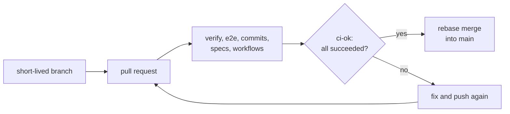

**Trade-offs**

- The trunk stays releasable, but every change waits for CI.
- Small, frequent merges need discipline: work is cut into slices that are safe
  to merge before the feature is finished.
- A gate with no bypass also blocks emergency fixes when CI itself breaks.
- An aggregator that runs "always" must treat cancelled and skipped jobs with
  care, or it can pass when a job never ran.

**How this repository applies it**

- [ci D1](../openspec/changes/archive/2026-10-18-ci-release-pipeline/design.md#d1-one-ci-workflow-with-a-few-coarse-jobs-and-an-aggregate-gate):
  the pattern _required-check aggregator_, as the `ci-ok` job in
  [ci.yml](../.github/workflows/ci.yml).
- [ci D9](../openspec/changes/archive/2026-10-18-ci-release-pipeline/design.md#d9-repository-settings-as-code):
  the `main` ruleset in [main.json](../.github/rulesets/main.json) requires
  `ci-ok` and allows only rebase merges.
- [ci D5](../openspec/changes/archive/2026-10-18-ci-release-pipeline/design.md#d5-commit-messages-checked-per-commit):
  every commit is checked, because a rebase merge puts every commit on `main`.

**What we learned here**

> Draft: awaiting the owner's rewrite.

- The ruleset could not be applied before `ci-ok` had reported once. Requiring
  a check that has never run would have blocked the change's own pull request.
- The required check's name must equal the job's `name`. It was confirmed
  against the pull request's real check runs before the rule was applied.
- With no bypass, a broken CI blocks every merge. The README documents a
  break-glass procedure, followed by re-running the settings script.
- Every update of the release pull request needs a manual "approve workflows"
  click, because it is created with the default token.

**Check yourself**

1. Why require one aggregate check instead of each job?

   

Answer

   The rule then names one stable check. Jobs can be added, renamed or skipped
   on some events without editing the rule, and a job that silently does not
   run cannot leave a gap in what is required.

   

2. How can a naive aggregator pass when a job did not succeed?

   

Answer

   It runs even when a needed job failed, so it must read each job's result. If
   it only checks for `failure`, a `cancelled` or unexpectedly `skipped` job
   counts as a pass.

   

3. What makes trunk-based development safe without long-lived release
   branches?

   

Answer

   The gate keeps the trunk working at every commit, and small changes keep
   each merge easy to review and to revert.

   

**Further reading**

- [Trunk Based Development](https://trunkbaseddevelopment.com/), Paul Hammant
  and contributors. Read on 2026-10-18.
- [Patterns for Managing Source Code Branches](https://martinfowler.com/articles/branching-patterns.html),
  Martin Fowler. Read on 2026-10-18.
- [Available rules for rulesets](https://docs.github.com/en/repositories/configuring-branches-and-merges-in-your-repository/managing-rulesets/available-rules-for-rulesets),
  GitHub Docs. Read on 2026-10-18.

### Release trains from Conventional Commits

**Status:** built (S1)

**What it is**

A release train ships whatever is ready at a regular point, instead of
waiting for a feature to finish. Here the "train" is a release pull request:
a bot keeps one open pull request that lists every change since the last
release. Merging it is the explicit, reviewed decision to release.

The bot knows what changed from the commit messages. Conventional Commits is a
format for them, such as `fix(admin): …` or `feat(welcome): …`. The type tells
the bot how to bump the version under semantic versioning, where a version
`MAJOR.MINOR.PATCH` says how much changed: a fix bumps the patch, a feature
the minor, a breaking change the major.

A single deploy definition means the automatic release and a manual redeploy
run the same workflow. A rollback then tests exactly the path a release uses.

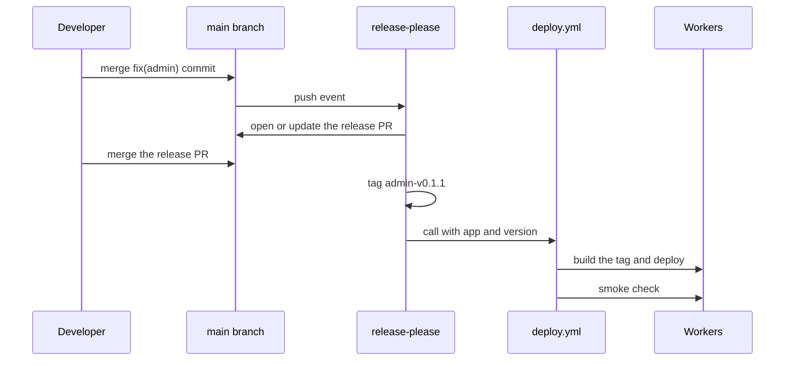

**Trade-offs**

- Versions come from history with no hand-written notes, but only if every
  commit message is accurate.
- A release waits for someone to merge the release pull request, which is a
  safety point and also a delay.
- Tools that publish on every merge are faster, but have no review step.
- Only paths the bot knows about get versions. A change elsewhere, such as in
  a shared package, needs a rule for how it reaches a release.

**How this repository applies it**

- [ci D8](../openspec/changes/archive/2026-10-18-ci-release-pipeline/design.md#d8-release-please-manifest-mode-apps-only-one-combined-pr):
  the pattern _release PR_, with one version per app in
  [release-please-config.json](../release-please-config.json)
  ([P9](DECISIONS.md#platform-and-scope)).
- [ci D5](../openspec/changes/archive/2026-10-18-ci-release-pipeline/design.md#d5-commit-messages-checked-per-commit):
  [commitlint.config.js](../commitlint.config.js) checks each commit locally
  and in CI.
- [edge D1](../openspec/changes/archive/2026-10-18-edge-infrastructure/design.md#d1-one-reusable-deploy-workflow-called-per-released-app):
  the pattern _single deploy definition_, as
  [deploy.yml](../.github/workflows/deploy.yml)
  ([P6](DECISIONS.md#platform-and-scope)).
- [P14](DECISIONS.md#platform-and-scope): how a shared-package change reaches
  a release.

**What we learned here**

> Draft: awaiting the owner's rewrite.

- A release created with the default `GITHUB_TOKEN` does not start other
  workflows. The deploy is therefore called from the release workflow, not
  triggered by the release event.
- release-please cannot count a shared package's commits toward an app. That
  gap became the `fix(<app>)` convention.
- The first release pull request failed the format check, because Prettier
  reformatted the generated changelogs. They are now ignored (PR #11).
- By default GitHub keeps one pending run per concurrency group and cancels an
  older one, so a third deploy could drop the second. Deploys now queue.

**Check yourself**

1. Why does a rollback through the same workflow matter?

   

Answer

   A rollback is usually needed under pressure. If it uses the path every
   release already uses, that path is known to work. A separate rollback
   script is rarely run, so it is the one most likely to be broken.

   

2. Which version does a `feat` commit produce for an app at 0.3.2 here?

   

Answer

   0.4.0. A feature bumps the minor version. Before 1.0.0 this repository also
   turns a breaking change into a minor bump, not a major one.

   

3. What is the cost of releasing through a reviewed pull request?

   

Answer

   A release waits until someone merges it. In return, nothing ships without
   an explicit decision, and the pull request shows what is about to ship.

   

**Further reading**

- [Conventional Commits 1.0.0](https://www.conventionalcommits.org/en/v1.0.0/),
  the Conventional Commits specification. Read on 2026-10-18.
- [Semantic Versioning 2.0.0](https://semver.org/spec/v2.0.0.html), Tom
  Preston-Werner. Read on 2026-10-18.
- [release-please](https://github.com/googleapis/release-please), Google, the
  project readme. Read on 2026-10-18.

### Settings as code

**Status:** built (S1)

**What it is**

Settings as code keeps the desired configuration of a system, such as branch
rules or access policies, in committed files. A program called a reconciler
compares the live system with those files and changes only what differs.

The reconciler must be idempotent: running it twice has the same effect as
running it once. That makes it safe to run at any time. A check mode that
reports differences without changing anything detects drift, which is a
difference made by hand outside the files.

The same idea, a loop that keeps moving the real state toward a desired state,
runs Kubernetes controllers and tools such as Terraform.

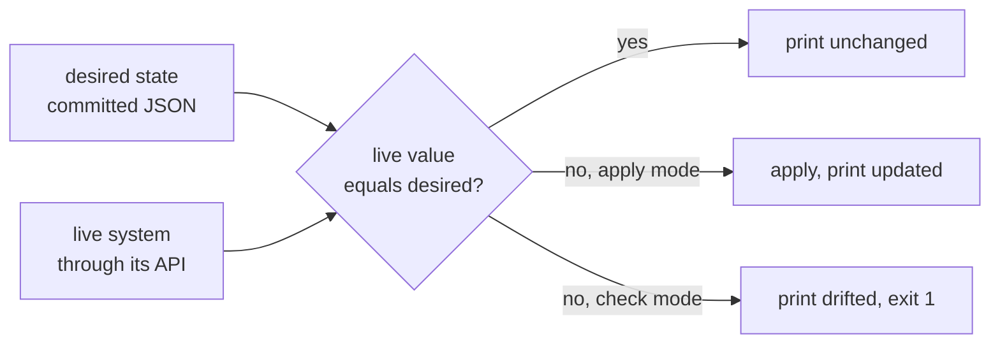

**Trade-offs**

- Every setting is reviewed, versioned and reproducible, but someone must write
  the reconciler, or adopt a tool that has one.
- A full tool such as Terraform keeps a state file and needs a provider for
  every system. A small script is lighter, but covers only what it manages.
- Without a scheduled check, drift is found only when someone runs the script.
- The reconciler needs strong credentials, which must be kept out of places
  where untrusted code runs.

**How this repository applies it**

- [ci D9](../openspec/changes/archive/2026-10-18-ci-release-pipeline/design.md#d9-repository-settings-as-code):
  the pattern _desired state plus an idempotent reconciler_, for GitHub, in
  [apply-settings.sh](../scripts/github/apply-settings.sh).
- [edge D5](../openspec/changes/archive/2026-10-18-edge-infrastructure/design.md#d5-access-topology-and-access-as-code):
  the same pattern for Cloudflare Access, in
  [apply-access.sh](../scripts/cloudflare/apply-access.sh)
  ([A4](DECISIONS.md#identity-and-access)).

**What we learned here**

> Draft: awaiting the owner's rewrite.

- The first release needed a workflow-permission setting turned on by hand,
  because the script did not manage it. It does now, so `--check` sees it.
- The first ruleset comparison ignored rules added outside the file. It now
  compares the full list of rule types, so an extra rule counts as drift.
- An API that answers "not found" for a disabled feature must be read
  carefully. Only a 404 means vulnerability alerts are off.
- An Access application deleted by hand comes back with a new audience tag. The
  script reports the mismatch, and `admin` refuses requests until the new tag is
  committed.

**Check yourself**

1. Why must a reconciler be idempotent?

   

Answer

   It is run again and again: after an edit, to check for drift, after an
   outage. If a second run changed anything, no run could be trusted to report
   the true state.

   

2. What does drift mean, and how is it found here?

   

Answer

   Drift is a live setting that differs from the committed file, usually after
   a change made by hand. Running a script with `--check` reports it and exits
   non-zero without changing anything.

   

3. Why do the scripts upsert an Access application instead of deleting and
   recreating it?

   

Answer

   Recreating it would give it a new audience tag, and `admin` verifies that
   tag. An upsert, an update when the item exists and a create when it does
   not, keeps the tag stable.

   

**Further reading**

- [Controllers](https://kubernetes.io/docs/concepts/architecture/controller/),
  Kubernetes documentation. Read on 2026-10-18.
- [InfrastructureAsCode](https://martinfowler.com/bliki/InfrastructureAsCode.html),
  Martin Fowler. Read on 2026-10-18.

### Supply-chain hardening

**Status:** built (S1)

**What it is**

A software supply chain is everything that goes into a build that you did not
write: dependencies, CI actions, container images and the tools that fetch
them. An attacker who changes any of these can run code in your build.
Supply-chain hardening reduces that risk in layers.

- **Pinning:** refer to an exact, unchangeable version. For a GitHub Action
  that is the full commit SHA, a fingerprint that cannot be moved the way a tag
  like `v4` can.
- **Auditing:** a tool reads the CI workflows and flags risky patterns, such as
  untrusted text pasted into a shell command.
- **Controlled updates:** a bot proposes updates in reviewable batches, on a
  schedule, while security fixes take a faster lane.

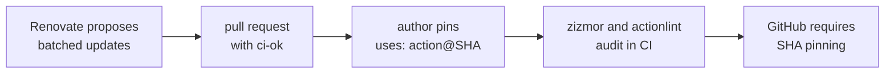

**Trade-offs**

- Pins make builds predictable, but they go stale without an update bot.
- Every update is a pull request to review, which costs time each week.
- An audit can flag false positives. Each accepted finding needs a written
  reason.
- An update bot is itself a third party with write access.

**How this repository applies it**

- [ci D10](../openspec/changes/archive/2026-10-18-ci-release-pipeline/design.md#d10-supply-chain-hardening-conventions):
  SHA pinning, and no event text inside shell commands, across
  [.github/workflows/](../.github/workflows/).
- [ci D7](../openspec/changes/archive/2026-10-18-ci-release-pipeline/design.md#d7-workflow-linting-and-auditing):
  workflow auditing with actionlint and zizmor.
- [ci D11](../openspec/changes/archive/2026-10-18-ci-release-pipeline/design.md#d11-renovate-mend-hosted-app):
  the pattern _batched dependency flow with a security fast lane_, in
  [renovate.json5](../renovate.json5).
- [ci D12](../openspec/changes/archive/2026-10-18-ci-release-pipeline/design.md#d12-codeql-default-setup):
  CodeQL code scanning, outside the required gate.

**What we learned here**

> Draft: awaiting the owner's rewrite.

- Renovate reads a container image's version from its tag, not from a comment.
  A digest-only reference could never be updated, so the reference now carries
  both.
- Pinning everything also pinned the Node engine range, which hid a major
  update from the approval rule. Engine and peer ranges stay ranges.
- A preset committed tooling updates as `fix(deps)`, which would have proposed
  app releases for tooling. The tooling groups now say `chore` explicitly.
- setup-bun caches by default. The deploy turns that off, so a release never
  restores a cache a pull request could have written.

**Check yourself**

1. Why pin an action to a SHA instead of a version tag?

   

Answer

   A tag can be moved to point at different code, so `v4` today may not be
   `v4` tomorrow. A commit SHA identifies one exact content and cannot be
   moved.

   

2. Name the three layers that keep actions pinned here.

   

Answer

   The authoring convention, the zizmor audit in CI, and GitHub's own setting
   that refuses unpinned actions.

   

3. Why do security fixes skip the weekly schedule?

   

Answer

   A known vulnerability is a reason to update now. Batching is a trade of
   speed for less review work, and that trade is wrong when the risk is known.

   

**Further reading**

- [Secure use reference](https://docs.github.com/en/actions/reference/security/secure-use),
  GitHub Docs. Read on 2026-10-18.
- [SLSA](https://slsa.dev/), Supply-chain Levels for Software Artifacts, the
  OpenSSF specification. Read on 2026-10-18.
- [zizmor](https://docs.zizmor.sh/), zizmor documentation. Read on 2026-10-18.
- [Renovate](https://docs.renovatebot.com/), Renovate documentation.
  Read on 2026-10-18.

### Reproducible toolchains

**Status:** built (S1)

**What it is**

A toolchain is the set of programs that build and test the code: the runtime,
the package manager and the libraries. It is reproducible when every machine,
a laptop or a CI runner, uses exactly the same versions. Then "it works on my
machine" means it works everywhere.

Three things make that so. Exact version pins in the manifest, with no range
such as `^1.2.0`. A lockfile, which records the exact version of every
dependency, including the dependencies of dependencies. And a frozen install,
which fails instead of changing the lockfile when the two disagree.

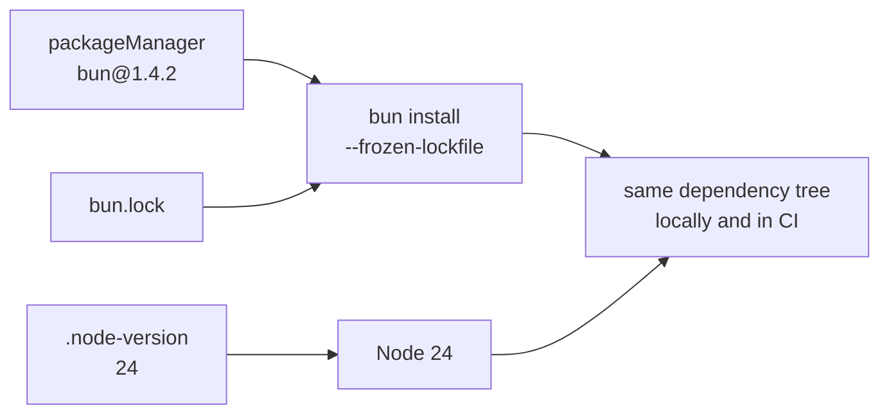

**Trade-offs**

- Builds repeat exactly, but nothing improves until someone updates the pins.
- Exact pins in a library make it hard for its users to share one copy of a
  dependency, which is why peer ranges stay ranges.
- Pinning the tools does not make the output byte-for-byte identical. That
  stronger goal, reproducible builds, also needs fixed timestamps and paths.

**How this repository applies it**

- [bootstrap D2](../openspec/changes/archive/2026-10-17-bootstrap-monorepo/design.md#d2-toolchain-pinning-exact-bun-node-24-lts-for-ci-node-24-allowed-locally):
  the exact Bun version in [package.json](../package.json) and Node in
  [.node-version](../.node-version).
- [ci D3](../openspec/changes/archive/2026-10-18-ci-release-pipeline/design.md#d3-toolchain-from-the-existing-pins-frozen-install):
  CI reads the same pins and installs from [bun.lock](../bun.lock) with a
  frozen install.

**What we learned here**

> Draft: awaiting the owner's rewrite.

- Vite, Wrangler and svelte-check start with a `node` shebang, so they run on
  Node even when Bun installs them. Pinning Bun alone would not pin their
  runtime.
- release-please bumps app versions but not `bun.lock`. A frozen install still
  passes, and the stale field is only cosmetic.
- The owner's laptop ran Node 26 while CI ran Node 24. CI is the authority,
  and the README recommends Node 24.

**Check yourself**

1. What does a lockfile add that exact pins in `package.json` do not?

   

Answer

   It fixes the dependencies of your dependencies too. Exact pins cover only
   the packages you list yourself.

   

2. Why use a frozen install in CI?

   

Answer

   If the manifest and the lockfile disagree, a normal install quietly
   rewrites the lockfile and CI tests a tree nobody committed. A frozen install
   fails instead, so the mismatch is fixed in a commit.

   

**Further reading**

- [Reproducible Builds](https://reproducible-builds.org/), the Reproducible
  Builds project. Read on 2026-10-18.
- [Lockfile](https://bun.com/docs/pm/lockfile), Bun documentation.
  Read on 2026-10-18.

### Least privilege

**Status:** built (S1)

**What it is**

Least privilege means each program or person gets only the access its task
needs, for only as long and as widely as it needs it. If a credential leaks or
a step is tricked, the damage is limited to that small scope. Saltzer and
Schroeder named it as a design principle for protecting information in 1975.

In CI, privilege has several scopes: what the token of each job may do, which
jobs can read a secret, and which branches can run those jobs.

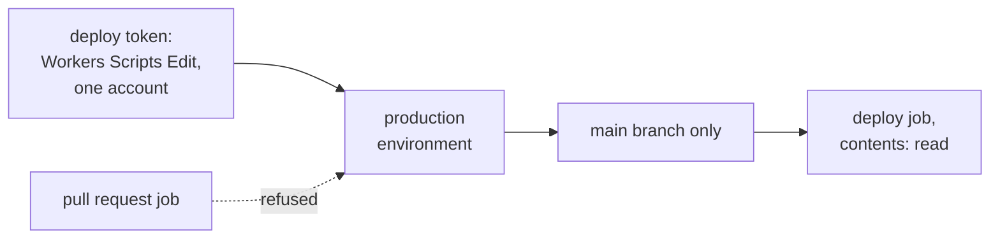

**Trade-offs**

- A leak does less harm, but finding the minimal set of permissions takes
  testing.
- Narrow permissions break when a tool starts needing more, and the error is
  not always clear.
- Many small credentials are more to rotate than one broad one.

**How this repository applies it**

- [edge D3](../openspec/changes/archive/2026-10-18-edge-infrastructure/design.md#d3-credentials-and-the-production-environment):
  the pattern _one credential, one environment, one branch_.
- [ci D2](../openspec/changes/archive/2026-10-18-ci-release-pipeline/design.md#d2-triggers-concurrency-and-token-scope):
  workflows start with no permissions, and each job grants only what it needs,
  in the `permissions:` blocks under
  [.github/workflows/](../.github/workflows/).

**What we learned here**

> Draft: awaiting the owner's rewrite.

- A job that uses an environment does not need `deployments: write`. GitHub
  creates the deployment record itself.
- The deploy token's final permission set was found by deploying once by hand
  before merge, not by guessing.
- The owner's token for Access changes is a separate credential and is never
  stored in GitHub, so CI cannot change who may sign in.

**Check yourself**

1. Why keep the deploy token in an environment instead of a repository secret?

   

Answer

   Any job in the repository can read a repository secret. An environment
   secret reaches only jobs that name the environment, and the environment
   allows only the `main` branch.

   

2. Why do workflows here start with `permissions: {}`?

   

Answer

   It makes no access the default. Each job must then ask for what it uses, so
   a new job cannot inherit broad rights by accident.

   

**Further reading**

- [The Protection of Information in Computer Systems](https://www.cs.virginia.edu/~evans/cs551/saltzer/),
  Jerome Saltzer and Michael Schroeder (1975). Read on 2026-10-18.
- [GITHUB_TOKEN](https://docs.github.com/en/actions/concepts/security/github_token),
  GitHub Docs. Read on 2026-10-18.
- [Create API token](https://developers.cloudflare.com/fundamentals/api/get-started/create-token/),
  Cloudflare documentation. Read on 2026-10-18.

### Zero trust and defense in depth

**Status:** built (S1)

**What it is**

Zero trust means no request is trusted because of where it comes from, such as
an office network. Every request must prove who sent it. An identity-aware
proxy, a gateway in front of the app, signs the user in and passes a signed
token with each request.

Defense in depth means more than one layer protects the same thing, so one
mistake does not open it. Here the edge proxy decides who may enter, and the
app checks the proof again itself.

The proof is a JSON Web Token (JWT): a small signed document that states who
the user is (`email`), who issued it (`iss`), which app it is for (`aud`) and
when it expires. The app checks the signature with the issuer's public keys, so
a token nobody signed is refused.

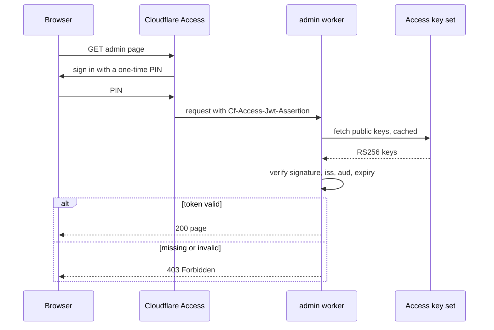

**Trade-offs**

- A bypass of one layer is not enough to get in, but each layer is more code
  to keep correct.
- The app now depends on the identity provider's key endpoint. If that fails,
  the owner is locked out. Failing closed is safer, and less convenient.
- Verifying a signature costs CPU on every request, which matters on a plan
  with a 10 ms limit.

**How this repository applies it**

- [A1](DECISIONS.md#identity-and-access), [A2](DECISIONS.md#identity-and-access)
  and [A5](DECISIONS.md#identity-and-access): Access in front of `admin`, and
  the worker re-verifies.
- [edge D6](../openspec/changes/archive/2026-10-18-edge-infrastructure/design.md#d6-in-worker-access-verification-a2):
  the pattern _the edge decides and the app re-verifies_, in
  [access.ts](../packages/edge/src/access.ts).
- [edge D5](../openspec/changes/archive/2026-10-18-edge-infrastructure/design.md#d5-access-topology-and-access-as-code):
  which URLs Access covers ([A4](DECISIONS.md#identity-and-access)).

**What we learned here**

> Draft: awaiting the owner's rewrite.

- Workers with static assets do not receive `ctx.access`, the identity that
  Access normally hands a worker. The worker had to read and verify the token
  header itself.
- Whether Access forwards the token to a Worker-level application was unknown
  until a live test before merge. The plan was to stop and ask if it did not.
- Static files are served without running the worker, so only Access protects
  them. They are public build output, so this was accepted.
- The first signed-in request after a deploy used 14 to 23 ms of CPU, above
  the 10 ms limit. The Free plan tolerates occasional overage, and warm
  requests used about 5 ms.

**Check yourself**

1. If Access already blocks strangers, why does the worker check the token?

   

Answer

   A second layer covers a mistake in the first: a misconfigured Access rule, a
   URL Access does not cover, or a request that reaches the worker another way.
   The worker trusts the signature, not the route the request took.

   

2. Which claims does the worker check besides the signature?

   

Answer

   The issuer (`iss`) must be the team's Access domain, the audience (`aud`)
   must be `admin`'s application tag, and the token must not be expired.

   

3. What happens when the key set cannot be fetched, and why?

   

Answer

   The request gets 403. The app fails closed: when it cannot prove who is
   asking, it refuses, even though that locks the owner out for a while.

   

**Further reading**

- [SP 800-207, Zero Trust Architecture](https://csrc.nist.gov/pubs/sp/800/207/final),
  NIST. Read on 2026-10-18.
- [RFC 7519, JSON Web Token](https://datatracker.ietf.org/doc/html/rfc7519),
  IETF. Read on 2026-10-18.
- [Validate JWTs](https://developers.cloudflare.com/cloudflare-one/access-controls/applications/http-apps/authorization-cookie/validating-json/),
  Cloudflare documentation. Read on 2026-10-18.

### Browser security headers and CSP

**Status:** built (S1)

**What it is**

A server can tell the browser to apply extra protections through response
headers. They cost nothing at run time and block whole classes of attack.

- **HSTS** (`Strict-Transport-Security`) tells the browser to use only HTTPS
  for the site, so a network attacker cannot downgrade the connection.
- **CSP** (Content Security Policy) lists where scripts, styles and other
  resources may come from. An injected script that is not on the list does not
  run. This is the main defense against cross-site scripting (XSS), where an
  attacker gets their script into your page.
- **`frame-ancestors`**, part of CSP, says which sites may show the page in a
  frame. `'none'` stops clickjacking, where a hidden frame tricks a click.
- **`Referrer-Policy`** limits how much of the current address is sent to other
  sites when a user follows a link.

A CSP can allow an inline script by a nonce, a random value per response, or by
a hash of the script's exact text. A hash stays the same for every response.

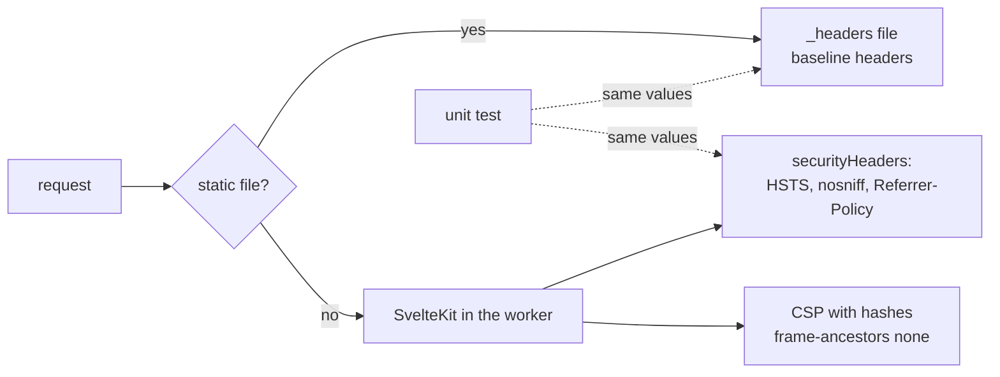

**Trade-offs**

- A strict CSP blocks injected code, but it also blocks legitimate inline code
  and third-party scripts until someone allows them on purpose.
- Nonces handle dynamic pages well, but a cached page would reuse one nonce for
  every visitor. Hashes cache well, but each allowed inline snippet needs its
  hash.
- HSTS is hard to undo: browsers remember it for the whole `max-age`.

**How this repository applies it**

- [I10](DECISIONS.md#integrations-and-longevity): security headers from the
  first deploy.
- [edge D8](../openspec/changes/archive/2026-10-18-edge-infrastructure/design.md#d8-security-headers-and-the-content-security-policy):
  the headers, the directives and why hashes, in
  [headers.ts](../packages/edge/src/headers.ts), with the static files'
  copies in [welcome's \_headers](../apps/welcome/_headers) and
  [admin's \_headers](../apps/admin/_headers).

**What we learned here**

> Draft: awaiting the owner's rewrite.

- Rules in a `_headers` file apply to static files only, not to responses the
  worker generates. Both sources are needed, and a test keeps them equal.
- SvelteKit puts an inline style on its screen-reader announcer and never
  hashes it. The policy allows that one style by its hash, with
  `'unsafe-hashes'`, which CSP3 requires for a style attribute.
- An inline `style` in `app.html` broke the hash-based policy and was removed.
- HSTS has no `preload` flag, because a `workers.dev` subdomain cannot be
  submitted to the browsers' preload list.

**Check yourself**

1. How does CSP stop a script an attacker managed to inject?

   

Answer

   The browser runs a script only if the policy allows its source or its hash.
   An injected inline script matches neither, so the browser refuses it and
   reports a violation.

   

2. Why does this repository use hashes rather than nonces?

   

Answer

   Sprint 2 plans to cache whole pages. A nonce differs per response, so a
   cached page would either share one nonce with everyone or skip the cache. A
   hash is the same for every response.

   

3. What does `frame-ancestors 'none'` prevent?

   

Answer

   It stops any site from showing the page in a frame, which prevents
   clickjacking.

   

**Further reading**

- [Content Security Policy (CSP)](https://developer.mozilla.org/en-US/docs/Web/HTTP/Guides/CSP),
  MDN Web Docs. Read on 2026-10-18.
- [Content Security Policy Level 3](https://www.w3.org/TR/CSP3/), W3C.
  Read on 2026-10-18.
- [RFC 6797, HTTP Strict Transport Security](https://datatracker.ietf.org/doc/html/rfc6797),
  IETF. Read on 2026-10-18.
- [OWASP Secure Headers Project](https://owasp.org/projects/secure-headers-project),
  OWASP. Read on 2026-10-18.
- [SvelteKit Vite plugin options](https://svelte.dev/docs/kit/@sveltejs-kit-vite),
  Svelte documentation, including `csp`. Read on 2026-10-18.

### Testing the production artifact

**Status:** built (S1)

**What it is**

An artifact is the built output that gets deployed. Testing the production
artifact means the tests run that exact output, on the same runtime as
production, rather than a development build. A difference between the two is
then caught before release.

Two rules keep this honest. Configuration, not code, changes between test and
production: the same build reads different settings. And there is no test-only
code path, such as "skip the check when testing", because such a path could be
switched on in production.

A trust anchor is the thing a check trusts in the end, such as the public keys
a token must be signed with. A test can inject its own trust anchor through
configuration and sign its own tokens, while production configuration points at
the real keys.

After a deploy, a smoke check, a quick test of the live system, confirms that
the release actually works.

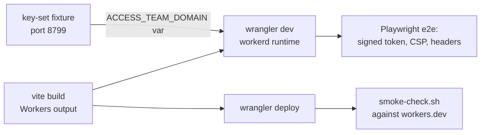

**Trade-offs**

- The tests are more faithful, but slower than tests on a development server.
- Configuration that can point at a test anchor must itself be checked, or a
  mistake could point production at the wrong keys.
- A smoke check proves only that the release starts and answers. It is not a
  full test.

**How this repository applies it**

- [edge D7](../openspec/changes/archive/2026-10-18-edge-infrastructure/design.md#d7-local-development-and-e2e-without-a-production-bypass):
  the pattern _a test trust anchor injected through configuration_, in
  [admin's e2e](../apps/admin/e2e/) and
  [welcome's e2e](../apps/welcome/e2e/).
- [edge D6](../openspec/changes/archive/2026-10-18-edge-infrastructure/design.md#d6-in-worker-access-verification-a2):
  a unit test that gates every deploy holds production to an Access origin.
- [bootstrap D6](../openspec/changes/archive/2026-10-17-bootstrap-monorepo/design.md#d6-tests-vitest-41-for-units-playwright-against-the-real-workers-runtime-for-smoke-tests):
  smoke tests run on workerd, not Node.
- [edge D11](../openspec/changes/archive/2026-10-18-edge-infrastructure/design.md#d11-post-deploy-smoke-check):
  the post-deploy smoke check, in
  [smoke-check.sh](../scripts/deploy/smoke-check.sh).

**What we learned here**

> Draft: awaiting the owner's rewrite.

- Wrangler's built-in `access.dev` block feeds `ctx.access`, which this app
  cannot see, so it could not serve as the test anchor.
- It was not known whether `wrangler dev` may fetch from `127.0.0.1`. It can,
  so the test fixture works and no weaker fallback was needed.
- During the bootstrap deploy, before Access existed, the `admin` smoke check
  passed on a 403. That is correct: the app stayed closed.

**Check yourself**

1. Why not add a "test mode" flag that skips the token check?

   

Answer

   The flag would ship in the production build. One wrong setting would turn
   the check off for everyone. A test anchor in configuration keeps the check
   running in every environment.

   

2. What stops production from trusting a test key set?

   

Answer

   A unit test reads the committed configuration and requires an Access
   domain. The deploy runs that test before it deploys.

   

3. Why run end-to-end tests on workerd instead of the Vite development
   server?

   

Answer

   The development server runs on Node. Production runs on workerd, which has
   different APIs and limits, so only workerd shows how the release behaves.

   

**Further reading**

- [ContinuousDelivery](https://martinfowler.com/bliki/ContinuousDelivery.html),
  Martin Fowler. Read on 2026-10-18.
- [III. Config](https://12factor.net/config), The Twelve-Factor App, Adam
  Wiggins. Read on 2026-10-18.

### Structured logs with a correlation id

**Status:** built (S1)

**What it is**

A structured log line is a record with named fields, such as JSON, instead of
free text. A log tool can then filter and count by field, for example every
`error` from `admin`.

A correlation id is one value that every record about the same request
carries. It ties together what the user saw, the log line and the trace, a
timeline of the request's steps. A user who reports "error, id X" gives you
the key to find everything about it.

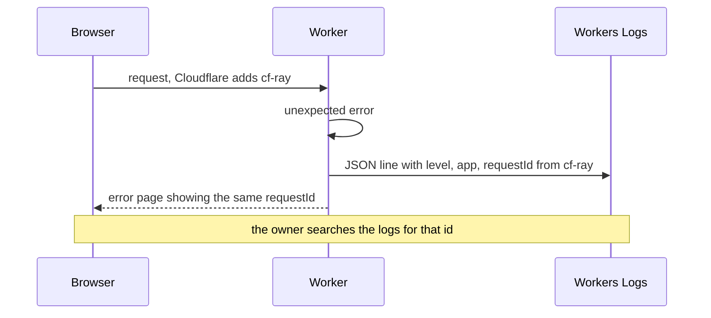

**Trade-offs**

- Records are easy to search, but each field is a choice about what is safe to
  log. Tokens, cookies and personal data must stay out.
- Logging every request costs storage and quota. Logging only errors leaves
  less to search.
- Using the platform's request id is free, but it exists only in production.

**How this repository applies it**

- [I9](DECISIONS.md#integrations-and-longevity): Cloudflare's built-in logs
  and traces, with no third-party tracker.
- [edge D9](../openspec/changes/archive/2026-10-18-edge-infrastructure/design.md#d9-structured-logging-and-error-handling):
  the pattern _structured logs with a correlation id_, using the Ray ID, in
  [logging.ts](../packages/edge/src/logging.ts).

**What we learned here**

> Draft: awaiting the owner's rewrite.

- The error handler first computed a local request id for the page, and the
  logger computed another one for the log. Without a `cf-ray` header, the page
  showed an id the log never had. It is now computed once.
- A log line per request was rejected. It would repeat the platform's own
  invocation logs and spend the free quota.
- The free logging limits change on 2026-12-01. The monthly usage check in
  ROADMAP covers it.

**Check yourself**

1. Why log JSON instead of plain sentences?

   

Answer

   A tool can filter and group by field, such as level or request id, without
   guessing at a text pattern.

   

2. How does the error page help the owner debug a failure?

   

Answer

   It shows the request id. The same id is on the error's log line and in the
   trace, so one search finds the full story.

   

**Further reading**

- [Workers Logs](https://developers.cloudflare.com/workers/observability/logs/workers-logs/),
  Cloudflare documentation. Read on 2026-10-18.
- [Cloudflare Ray ID](https://developers.cloudflare.com/fundamentals/reference/cloudflare-ray-id/),
  Cloudflare documentation. Read on 2026-10-18.
- [XI. Logs](https://12factor.net/logs), The Twelve-Factor App, Adam Wiggins.
  Read on 2026-10-18.
- [Trace Context](https://www.w3.org/TR/trace-context/), W3C.
  Read on 2026-10-18.

### Fitness functions

**Status:** built (S1)

**What it is**

A fitness function is an automated check that a property of the architecture
still holds, such as "no package imports an app" or "every document has a
diagram". It turns a rule people would otherwise have to remember into a test
that fails the build.

A structural fitness function checks the shape of files, not behavior. It is
cheap to run on every change, so a rule cannot quietly erode over time.

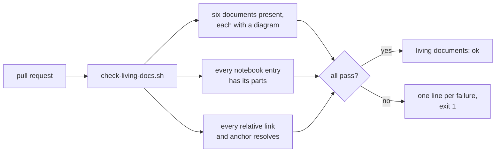

**Trade-offs**

- A rule is enforced without anyone remembering it, but each check is code to
  maintain.
- A structural check proves shape, not quality. A diagram can exist and still
  be wrong.
- A check that fails for reasons outside the change, such as a website being
  down, teaches people to ignore it. Checks here stay offline.

**How this repository applies it**

- [living-docs D4](../openspec/changes/archive/2026-10-18-living-docs/design.md#d4-ci-check-presence-plus-a-diagram-block-in-the-specs-job):
  the pattern _structural fitness function_, the first version of
  [check-living-docs.sh](../scripts/docs/check-living-docs.sh).
- [notebook D7](../openspec/changes/archive/2026-10-18-system-design-notebook/design.md#d7-entry-structure-check-awk-inside-the-existing-script):
  the entry-structure check for this notebook.
- [notebook D8](../openspec/changes/archive/2026-10-18-system-design-notebook/design.md#d8-relative-link-check-remark-cli-and-remark-validate-links-pinned-as-root-dev-dependencies):
  the relative-link check, offline.

**What we learned here**

> Draft: awaiting the owner's rewrite.

- The first check proved only that a diagram block exists. A broken diagram
  still passes, so diagrams are checked by eye on each pull request.
- Links between documents were checked once, by hand, and then by nothing.
  This notebook added the link check.
- The link checker needs a git remote named `origin`. The script checks for it
  first and explains how to add one.

**Check yourself**

1. What makes a check a fitness function rather than an ordinary test?

   

Answer

   It guards a property of the architecture or the project as a whole, not the
   behavior of one function.

   

2. Why are external links not checked in CI?

   

Answer

   An external site can be down for reasons that have nothing to do with the
   change, and the check would then fail at random. External links are
   re-checked by hand each quarter instead.

   

**Further reading**

- [Architectural fitness function](https://www.thoughtworks.com/radar/techniques/architectural-fitness-function),
  Thoughtworks Technology Radar. Read on 2026-10-18.
- [Building Evolutionary Architectures](https://evolutionaryarchitecture.com/),
  Neal Ford, Rebecca Parsons, Patrick Kua and Pramod Sadalage, 2nd edition,
  O'Reilly. Read on 2026-10-18.

### Documentation as a bounded context

**Status:** built (S1)

**What it is**

A bounded context comes from domain-driven design: a clear boundary inside
which one model and one set of words apply. Applied to documentation, each
document owns one topic. The others link to it instead of copying it, so each
fact has a single source of truth and is fixed in one place.

Two habits support it. A fixed outline per document, so an update edits a
known section. And a visual encoding of lifecycle state, such as solid boxes
for what exists and dashed boxes for what is planned, so a reader sees at a
glance how far the system has come.

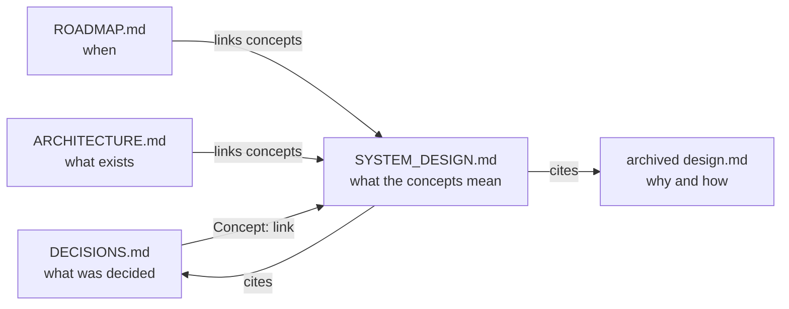

**Trade-offs**

- A fact changes in one place, but a reader follows links to get the whole
  picture.
- Clear owners need a rule for every new topic: which document gets it.
- Links break when headings move, so they need a check.

**How this repository applies it**

- [living-docs D1](../openspec/changes/archive/2026-10-18-living-docs/design.md#d1-one-owner-per-topic-a-fixed-outline-per-document):
  the pattern _documentation as a bounded context_, one owner per topic.
- [living-docs D2](../openspec/changes/archive/2026-10-18-living-docs/design.md#d2-diagram-conventions):
  the pattern _visual encoding of lifecycle state_.
- [living-docs D3](../openspec/changes/archive/2026-10-18-living-docs/design.md#d3-citing-decisions-and-roadmap-state):
  decisions are cited by identifier, never restated.
- [notebook D6](../openspec/changes/archive/2026-10-18-system-design-notebook/design.md#d6-links-between-the-notebook-and-the-other-documents):
  how this notebook and the other documents link to each other
  ([P8](DECISIONS.md#platform-and-scope), [P15](DECISIONS.md#platform-and-scope)).

**What we learned here**

> Draft: awaiting the owner's rewrite.

- Fixing the number of documents at five was enforced in four places: two
  specs, the check script, the archive guidance and the README. Adding a sixth
  touched all of them.
- DECISIONS.md records outcomes only, so nothing explained the concepts
  themselves. That gap is why this notebook exists.
- The decision log is close to its own 300-line limit, so each link added to it
  has a cost.

**Check yourself**

1. What is the cost of copying a fact into a second document?

   

Answer

   When the fact changes, both copies must change. Sooner or later one is
   missed, and readers cannot tell which copy is right.

   

2. Why do the documents say "planned (S2)" instead of a status such as
   "proposed"?

   

Answer

   Status lives in ROADMAP.md only. A status change then never forces an edit
   in the other documents.

   

**Further reading**

- [BoundedContext](https://martinfowler.com/bliki/BoundedContext.html), Martin
  Fowler. Read on 2026-10-18.
- [Diátaxis](https://diataxis.fr/), Daniele Procida. Read on 2026-10-18.
- [The C4 model](https://c4model.com/), Simon Brown. Read on 2026-10-18.
- [ISO 24495-1:2023, Plain language](https://www.iso.org/standard/78907.html),
  ISO. Read on 2026-10-18.

## Sprint 2: Publish path

**Study path:** study before the sprint starts, in this order. Begin with
[hexagonal architecture](#hexagonal-architecture-ports-and-adapters), because
it shapes every package in the sprint. Then read
[CQRS-lite read projections](#cqrs-lite-read-projections) and
[append-only revisions](#event-sourcing-lite-append-only-revisions) together:
they are the write and read sides of publishing. Next,
[schema versioning with upcasters](#schema-versioning-with-upcasters) and
[versioned contracts](#versioned-contracts-and-tolerant-readers), which keep
old data readable. Finish with
[cache invalidation by tag](#cache-invalidation-by-tag) and
[branch-per-PR database testing](#branch-per-pr-database-testing). After the
sprint, each entry is completed when its change is archived.

### Hexagonal architecture (ports and adapters)

**Status:** planned (S2)

**What it is**

Hexagonal architecture puts the core logic of an application in the middle,
with no knowledge of databases, frameworks or networks. The core defines ports:
interfaces that say what it needs, such as "save a revision". Adapters
implement those ports for a real technology, such as Postgres. The core can
then be tested with fake adapters, and a technology can be replaced without
touching it.

**Check yourself**

1. What is the difference between a port and an adapter?

   

Answer

   A port is an interface the core owns and describes in its own terms. An
   adapter is code outside the core that implements the port with a real
   technology.

   

2. Which way do the dependencies point?

   

Answer

   Inward. Adapters depend on the core's ports, and the core depends on
   nothing outside itself.

   

**Further reading**

- [Hexagonal architecture](https://alistair.cockburn.us/hexagonal-architecture),
  Alistair Cockburn. Read on 2026-10-18.
- [PresentationDomainDataLayering](https://martinfowler.com/bliki/PresentationDomainDataLayering.html),
  Martin Fowler. Read on 2026-10-18.

### CQRS-lite read projections

**Status:** planned (S2)

**What it is**

CQRS, command query responsibility segregation, uses one model to change data
and a separate model to read it. A read projection is a copy of the data
shaped for one kind of read, built from the write model, such as a ready-made
page snapshot. "Lite" means both sides share one database of record, and the
projection is rebuilt when the source changes, rather than splitting into
separate systems.

**Check yourself**

1. Why keep a separate read model at all?

   

Answer

   Reads and writes have different needs. A read model shaped for one page is
   fast and simple to serve, while the write model stays shaped for editing
   and rules.

   

2. How is a projection different from a cache filled on a miss?

   

Answer

   A projection is written when the source changes, ahead of any read. A
   cache-aside entry is filled only when a read misses, so the first reader
   pays for it.

   

3. What must exist so a projection can always be rebuilt?

   

Answer

   A source of truth that holds everything the projection is made from.

   

**Further reading**

- [CQRS](https://martinfowler.com/bliki/CQRS.html), Martin Fowler.
  Read on 2026-10-18.
- [CQRS pattern](https://learn.microsoft.com/en-us/azure/architecture/patterns/cqrs),
  Microsoft Azure Architecture Center. Read on 2026-10-18.
- [Materialized View pattern](https://learn.microsoft.com/en-us/azure/architecture/patterns/materialized-view),
  Microsoft Azure Architecture Center. Read on 2026-10-18.

### Event-sourcing-lite append-only revisions

**Status:** planned (S2)

**What it is**

Event sourcing stores every change as a new record and never overwrites old
ones. The current state is derived from that history. "Lite" here means
storing whole revisions, complete copies of an entry at each save, rather than
small events. Nothing is lost, any old version can be shown or restored, and
publishing becomes moving a pointer to one revision.

**Check yourself**

1. What does an append-only table give up, and what does it gain?

   

Answer

   It uses more storage, because nothing is deleted. It gains a full history:
   every past state can be shown, compared or restored.

   

2. Why does publishing by moving a pointer make rollback easy?

   

Answer

   The old revision still exists. Rolling back is moving the pointer back,
   with no data to rebuild.

   

**Further reading**

- [Event Sourcing](https://martinfowler.com/eaaDev/EventSourcing.html), Martin
  Fowler. Read on 2026-10-18.
- [Event Sourcing pattern](https://learn.microsoft.com/en-us/azure/architecture/patterns/event-sourcing),
  Microsoft Azure Architecture Center. Read on 2026-10-18.

### Schema versioning with upcasters

**Status:** planned (S2)

**What it is**

A schema is the shape of stored data. When records are never rewritten, old
records keep the old shape after the schema changes. Each record therefore
stores its schema version. An upcaster is a small function that converts a
record from one version to the next, so the code only ever handles the latest
shape. Fixture tests, saved examples of each old version, prove each upcaster
still works.

**Check yourself**

1. Why convert old records on read instead of rewriting them all?

   

Answer

   Append-only history must not be rewritten. Converting on read keeps the
   original records intact.

   

2. How do several upcasters handle a record three versions old?

   

Answer

   They run as a chain, each one moving the record up one version, until it
   reaches the current shape.

   

**Further reading**

- [Versioning in an Event Sourced System](https://leanpub.com/esversioning),
  Greg Young, Leanpub. Read on 2026-10-18.
- [Designing Data-Intensive Applications](https://dataintensive.net/), Martin
  Kleppmann, O'Reilly, chapter 4 "Encoding and Evolution". Read on 2026-10-18.

### Versioned contracts and tolerant readers

**Status:** planned (S2)

**What it is**

A contract is the agreed shape of data that one part of a system sends and
another reads. Giving the contract a version number lets both sides change at
different times. A tolerant reader accepts what it understands and ignores
what it does not, and can read the current and the previous version. The
producer and the consumer can then deploy in either order.

**Check yourself**

1. Why must the reader accept the previous version as well?

   

Answer

   During a deploy, or until old data is rewritten, both versions exist. A
   reader that accepted only the newest would break in that window.

   

2. What should a tolerant reader do with a field it does not know?

   

Answer

   Ignore it, so a producer can add fields without breaking the reader.

   

**Further reading**

- [TolerantReader](https://martinfowler.com/bliki/TolerantReader.html), Martin
  Fowler. Read on 2026-10-18.
- [Consumer-Driven Contracts](https://martinfowler.com/articles/consumerDrivenContracts.html),
  Ian Robinson, on martinfowler.com. Read on 2026-10-18.
- [RFC 9413, Maintaining Robust Protocols](https://datatracker.ietf.org/doc/html/rfc9413),
  IETF. Read on 2026-10-18.

### Cache invalidation by tag

**Status:** planned (S2)

**What it is**

A cache keeps copies of responses so they are served without being rebuilt.
The hard part is invalidation: removing a copy when its content changes.
Tagging labels each cached response with the things it contains, such as an
entry, a content type and a locale. A change then purges every response with
a matching tag, without knowing their addresses.

**Check yourself**

1. Why purge by tag instead of by address?

   

Answer

   One entry can appear on many pages, such as its own page, a list and a
   feed. A tag reaches all of them without keeping a list of addresses.

   

2. What happens if a page is missing a tag it should carry?

   

Answer

   A purge for that tag misses the page, and it keeps serving stale content
   until it expires.

   

**Further reading**

- [Purge cache by cache-tags](https://developers.cloudflare.com/cache/how-to/purge-cache/purge-by-tags/),
  Cloudflare documentation. Read on 2026-10-18.
- [RFC 9111, HTTP Caching](https://datatracker.ietf.org/doc/html/rfc9111),
  IETF. Read on 2026-10-18.

### Branch-per-PR database testing

**Status:** planned (S2)

**What it is**

Integration tests need a real database, but a shared test database collects
leftovers and lets runs disturb each other. Some databases can create a
branch: a fast, copy-on-write clone that shares unchanged data with its
parent. Creating one branch per pull request gives each run its own fresh
database, which is migrated, tested against and then deleted.

**Check yourself**

1. Why not share one test database between pull requests?

   

Answer

   Two runs at once would change each other's data, and leftovers from one run
   would affect the next. Tests would fail at random.

   

2. What does a branch per pull request need from CI, and what does that mean
   for forks?

   

Answer

   It needs an API key to create and delete branches. Secrets are not given to
   pull requests from forks, so those runs skip these tests.

   

**Further reading**

- [Branching](https://neon.com/docs/introduction/branching), Neon
  documentation. Read on 2026-10-18.
- [Automate branching with GitHub Actions](https://neon.com/docs/guides/branching-github-actions),
  Neon documentation. Read on 2026-10-18.
- [Evolutionary Database Design](https://martinfowler.com/articles/evodb.html),
  Pramod Sadalage and Martin Fowler. Read on 2026-10-18.

## Sprint 3: Media, inbox and backups

**Study path:** study before the sprint starts. Read
[content-addressed storage](#content-addressed-storage) first, then
[upload protocols](#upload-protocols-and-integrity-checks), which builds on it.
Then [abuse prevention](#abuse-prevention) for the contact form, and
[backup and restore](#backup-and-restore-as-a-tested-process) last, since it
protects everything before it.

### Content-addressed storage

**Status:** planned (S3)

**What it is**

In content-addressed storage, a file's name is the hash of its content, such
as a SHA-256 fingerprint. The same content always gets the same name, so
duplicates are stored once, and a name can be cached forever because its
content can never change. A different file gets a different name.

**Check yourself**

1. Why can a content-addressed file be cached forever?

   

Answer

   If the content changed, its hash and so its name would change too. The
   content at one name never changes.

   

2. What happens when the same image is uploaded twice?

   

Answer

   It gets the same hash and the same name, so it is stored once.

   

**Further reading**

- [Git Internals: Git Objects](https://git-scm.com/book/en/v2/Git-Internals-Git-Objects),
  Pro Git, Scott Chacon and Ben Straub. Read on 2026-10-18.
- [Content addressing](https://docs.ipfs.tech/concepts/content-addressing/),
  IPFS documentation. Read on 2026-10-18.

### Upload protocols and integrity checks

**Status:** planned (S3)

**What it is**

An upload protocol is the sequence of requests that moves a file to the
server, such as create, then send parts, then complete. Splitting it into
steps lets a large file move in parts and lets a failed part be retried. An
integrity check proves the stored file is the one that was sent: the client
computes the file's hash, and the server compares it with what it received.

**Check yourself**

1. Why have a separate "complete" step?

   

Answer

   It marks the moment all parts have arrived and are checked. Until then, the
   file is not visible, so a half-finished upload is never served.

   

2. What does the client's hash protect against?

   

Answer

   A file damaged or changed on the way. If the hashes differ, the upload is
   refused.

   

**Further reading**

- [Upload objects](https://developers.cloudflare.com/r2/objects/upload-objects/),
  Cloudflare R2 documentation. Read on 2026-10-18.
- [SubtleCrypto: digest()](https://developer.mozilla.org/en-US/docs/Web/API/SubtleCrypto/digest),
  MDN Web Docs. Read on 2026-10-18.
- [Subresource Integrity](https://www.w3.org/TR/sri/), W3C.
  Read on 2026-10-18.

### Abuse prevention

**Status:** planned (S3)

**What it is**

Any public form attracts automated abuse: spam, credential stuffing or
floods of requests. Abuse prevention combines layers. A challenge, such as an
invisible test that a real browser passes, separates people from simple bots.
Rate limiting caps how many requests one source may send in a period. Each
layer stops a different kind of attack.

**Check yourself**

1. Why use both a challenge and a rate limit?

   

Answer

   A challenge stops bots that cannot run a real browser. A rate limit stops a
   flood from a source that passes the challenge. Neither covers both.

   

2. Where must the challenge be checked, and why?

   

Answer

   On the server. A check only in the browser can be skipped by sending the
   request directly.

   

**Further reading**

- [Turnstile](https://developers.cloudflare.com/turnstile/), Cloudflare
  documentation. Read on 2026-10-18.
- [Rate limiting rules](https://developers.cloudflare.com/waf/rate-limiting-rules/),
  Cloudflare documentation. Read on 2026-10-18.
- [OWASP Automated Threats to Web Applications](https://owasp.org/projects/automated-threats-to-web-applications),
  OWASP. Read on 2026-10-18.

### Backup and restore as a tested process

**Status:** planned (S3)

**What it is**

A backup is only useful if it can be restored, and the only proof is to
restore it. Two numbers set the goal. The recovery point objective (RPO) is
how much recent data you can afford to lose, such as one day. The recovery
time objective (RTO) is how long recovery may take. A restore drill, done on a
schedule, proves both numbers are met.

**Check yourself**

1. What does a nightly backup mean for the RPO?

   

Answer

   Up to one day of changes can be lost, so the RPO is at most 24 hours.

   

2. Why does an untested backup count for little?

   

Answer

   It may be incomplete, unreadable or missing a step needed to restore it.
   Only a restore shows that it works.

   

**Further reading**

- [SQL Dump](https://www.postgresql.org/docs/current/backup-dump.html),
  PostgreSQL documentation. Read on 2026-10-18.
- [Data Integrity: What You Read Is What You Wrote](https://sre.google/sre-book/data-integrity/),
  Site Reliability Engineering, Google. Read on 2026-10-18.
- [Branch restore](https://neon.com/docs/postgres/backup-restore/branch-restore),
  Neon documentation. Read on 2026-10-18.

## Sprint 4: Scheduling, preview and localization

**Study path:** study before the sprint starts. Re-read
[settings as code](#settings-as-code) from Sprint 1, then
[reconciliation loops](#reconciliation-loops-and-at-most-once-claims), which
apply the same loop to data. Then
[eventual consistency](#eventual-consistency-and-its-slos) and
[read-your-writes](#read-your-writes-for-previews), which explain what the
owner sees and when. Finish with [time in UTC](#time-handling-in-utc) and
[internationalization versus localization](#internationalization-versus-localization).

### Reconciliation loops and at-most-once claims

**Status:** planned (S4)

**What it is**

A reconciliation loop runs on a schedule, compares the desired state with the
real state and fixes the difference. It is the same idea as
[settings as code](#settings-as-code), applied to data such as entries due for
publishing. When two runs may overlap, each item must be claimed so only one
run handles it. An at-most-once claim is an atomic update, one the database
applies completely or not at all, that succeeds only if the item is still
unclaimed.

**Check yourself**

1. Why is a scheduled loop more robust than doing the work once at the right
   moment?

   

Answer

   If one run fails or is missed, the next run sees the difference and fixes
   it. Nothing depends on a single moment.

   

2. How does a conditional update stop two runs from publishing the same
   entry?

   

Answer

   Each run updates the entry only where it is still unclaimed. The database
   applies one update first, so the second finds no matching row and skips it.

   

**Further reading**

- [Transaction Isolation](https://www.postgresql.org/docs/current/transaction-iso.html),
  PostgreSQL documentation. Read on 2026-10-18.
- [Cron Triggers](https://developers.cloudflare.com/workers/configuration/cron-triggers/),
  Cloudflare documentation. Read on 2026-10-18.

### Eventual consistency and its SLOs

**Status:** planned (S4)

**What it is**

In an eventually consistent system, a change reaches every copy of the data
after a delay, not at once. Readers may briefly see old data. A service level
objective (SLO) puts a number on "eventually", such as "a scheduled entry is
live within two minutes of its time". The number turns a vague delay into a
target that can be measured.

**Check yourself**

1. Why accept stale reads at all?

   

Answer

   Copies close to readers are fast and keep working when the source is busy
   or far away. The price is a short delay before they see changes.

   

2. What makes an SLO useful?

   

Answer

   It is a number that can be measured, so you can tell whether the system
   meets it and when it stops doing so.

   

**Further reading**

- [Eventually Consistent](https://www.allthingsdistributed.com/2008/12/eventually_consistent.html),
  Werner Vogels. Read on 2026-10-18.
- [Service Level Objectives](https://sre.google/sre-book/service-level-objectives/),
  Site Reliability Engineering, Google. Read on 2026-10-18.
- [How KV works](https://developers.cloudflare.com/kv/concepts/how-kv-works/),
  Cloudflare documentation. Read on 2026-10-18.

### Time handling in UTC

**Status:** planned (S4)

**What it is**

Coordinated Universal Time (UTC) is one time scale with no daylight saving
changes. Storing and comparing every time in UTC avoids errors such as an hour
that happens twice, or two servers in different zones disagreeing. A time is
converted to the reader's time zone only when it is shown.

**Check yourself**

1. Why not store times in the owner's local zone?

   

Answer

   Local time can jump or repeat when daylight saving changes, and servers may
   run in other zones. UTC never jumps.

   

2. When is a time converted to a local zone?

   

Answer

   Only at the edge of the system, when it is shown to a person or read from
   their input.

   

**Further reading**

- [RFC 3339, Date and Time on the Internet](https://datatracker.ietf.org/doc/html/rfc3339),
  IETF. Read on 2026-10-18.
- [Date/Time Types](https://www.postgresql.org/docs/current/datatype-datetime.html),
  PostgreSQL documentation. Read on 2026-10-18.
- [Date](https://developer.mozilla.org/en-US/docs/Web/JavaScript/Reference/Global_Objects/Date),
  MDN Web Docs. Read on 2026-10-18.

### Internationalization versus localization

**Status:** planned (S4)

**What it is**

Internationalization (i18n) is designing software so it can support many
languages and regions without changes to its code: text kept out of the code,
dates and numbers formatted by locale, room for longer words. Localization
(l10n) is the work of adapting it to one locale, such as translating the text
into Filipino. Internationalization is done once. Localization is done per
locale.

**Check yourself**

1. Is adding Esperanto translations internationalization or localization?

   

Answer

   Localization. Internationalization is what made adding a locale possible
   without changing the code.

   

2. Why are UI strings and content handled separately?

   

Answer

   UI strings ship with the code and change with releases. Content is written
   in the CMS and changes without a release.

   

**Further reading**

- [Localization vs. Internationalization](https://www.w3.org/International/questions/qa-i18n),
  W3C Internationalization. Read on 2026-10-18.
- [Paraglide JS](https://paraglidejs.com/), inlang. Read on 2026-10-18.
- [Intl](https://developer.mozilla.org/en-US/docs/Web/JavaScript/Reference/Global_Objects/Intl),
  MDN Web Docs. Read on 2026-10-18.

### Read-your-writes for previews

**Status:** planned (S4)

**What it is**

Read-your-writes is a consistency guarantee: after you save something, your
own next read shows it, even if other readers may still see the old version.
Without it, an editor saves a draft and the preview shows the previous text,
because it read a copy that has not caught up. Reading the preview from the
source of truth gives the editor this guarantee.

**Check yourself**

1. Why might a preview show old text without this guarantee?

   

Answer

   It may read from a copy, such as a cache or a projection, that has not yet
   received the save.

   

2. Does read-your-writes mean every visitor sees the change at once?

   

Answer

   No. It covers only the person who wrote. Other readers may still see the
   old version for a while.

   

**Further reading**

- [Read your writes](https://jepsen.io/consistency/models/read-your-writes),
  Jepsen consistency models. Read on 2026-10-18.
- [Eventually Consistent](https://www.allthingsdistributed.com/2008/12/eventually_consistent.html),
  Werner Vogels. Read on 2026-10-18.

## Sprint 5: Brand

**Study path:** study before the sprint starts. Read
[design tokens](#design-tokens-and-theming) first, because the other brand work
uses them. Then [accessibility](#accessibility-as-a-requirement) and
[font loading](#font-subsetting-and-loading), then
[performance budgets](#performance-budgets), and
[privacy-preserving analytics](#privacy-preserving-analytics) last.

### Design tokens and theming

**Status:** planned (S5)

**What it is**

A design token is a named design value, such as `color.text.primary` or
`space.4`, stored once and used everywhere. Brand tokens hold raw values.
Semantic tokens name a purpose and point at a brand token. A theme, such as a
dark mode, changes what the semantic tokens point at, and every component
follows without being edited.

**Check yourself**

1. Why have semantic tokens on top of brand tokens?

   

Answer

   Components use the purpose, such as "text on a surface". A theme or a
   rebrand then changes one mapping instead of every component.

   

2. What does a format standard for tokens make possible?

   

Answer

   Tools can read and write the same token files, so design tools and code
   share one source.

   

**Further reading**

- [Design Tokens Format Module](https://www.designtokens.org/tr/drafts/format/),
  W3C Design Tokens Community Group. Read on 2026-10-18.
- [Theme variables](https://tailwindcss.com/docs/theme), Tailwind CSS
  documentation. Read on 2026-10-18.

### Accessibility as a requirement

**Status:** planned (S5)

**What it is**

Accessibility means people with disabilities can use the site, for example
with a screen reader, a keyboard only or low vision. Treating it as a
requirement means it has a measurable target, such as WCAG 2.2 level AA, and
automated checks that fail the build. Automated tools catch only part of the
problems, so manual checks remain.

**Check yourself**

1. Why make accessibility a failing check rather than a review item?

   

Answer

   A check runs on every change and cannot be forgotten. Problems are fixed
   when they are introduced, not found later.

   

2. What can automated checks not tell you?

   

Answer

   Whether the page makes sense: a meaningful text alternative, a logical
   reading order or a usable flow with a keyboard. Those need a person.

   

**Further reading**

- [WCAG 2.2](https://www.w3.org/TR/WCAG22/), W3C Recommendation.
  Read on 2026-10-18.
- [WCAG overview](https://www.w3.org/WAI/standards-guidelines/wcag/), W3C Web
  Accessibility Initiative. Read on 2026-10-18.
- [axe-core](https://github.com/dequelabs/axe-core), Deque Systems.
  Read on 2026-10-18.

### Font subsetting and loading

**Status:** planned (S5)

**What it is**

A font file holds glyphs, the shapes of characters, for many scripts. A subset
keeps only the characters a site needs, such as Latin plus Latin Extended-A,
which makes the file much smaller. Loading rules decide what the browser shows
while the font downloads: fallback text first, then a swap, so text is never
invisible.

**Check yourself**

1. What goes wrong if the subset lacks a character the content uses?

   

Answer

   The browser draws that character with a fallback font, so a word mixes two
   typefaces. Esperanto's ĉ or ŝ are examples here.

   

2. What does `font-display: swap` trade?

   

Answer

   Text appears at once in a fallback font, then shifts when the real font
   arrives. Readers never wait, but the page may move slightly.

   

**Further reading**

- [font-display](https://developer.mozilla.org/en-US/docs/Web/CSS/Reference/At-rules/@font-face/font-display),
  MDN Web Docs. Read on 2026-10-18.
- [unicode-range](https://developer.mozilla.org/en-US/docs/Web/CSS/Reference/At-rules/@font-face/unicode-range),
  MDN Web Docs. Read on 2026-10-18.
- [CSS Fonts Module Level 4](https://www.w3.org/TR/css-fonts-4/), W3C.
  Read on 2026-10-18.

### Performance budgets

**Status:** planned (S5)

**What it is**

A performance budget is a limit the site must stay under, such as page weight,
load time or a score. A check in CI measures each change against it and fails
when the budget is exceeded. Performance then stops degrading one small
change at a time.

**Check yourself**

1. Why measure in CI instead of now and then?

   

Answer

   Each change is small, so no single one looks harmful. A check on every
   change catches the one that crosses the line.

   

2. What is the difference between a lab and a field measurement?

   

Answer

   A lab test runs in a controlled setup, such as CI. Field data comes from
   real visitors on their own devices and networks. Budgets in CI use lab
   numbers.

   

**Further reading**

- [Performance budgets 101](https://web.dev/articles/performance-budgets-101),
  web.dev, Google. Read on 2026-10-18.
- [Lighthouse CI](https://github.com/GoogleChrome/lighthouse-ci), Google
  Chrome. Read on 2026-10-18.
- [Web Vitals](https://web.dev/articles/vitals), web.dev, Google.
  Read on 2026-10-18.

### Privacy-preserving analytics

**Status:** planned (S5)

**What it is**

Privacy-preserving analytics counts visits without tracking people: no
cookies, no fingerprinting, no profile that follows a visitor between sites.
It answers questions such as "which pages are read" from aggregate numbers.
Collecting less data also means less to protect and fewer legal duties, which
data minimization, a principle of the EU's GDPR, asks for.

**Check yourself**

1. What question can such analytics not answer?

   

Answer

   What one particular person did across visits, because no identifier ties
   the visits together.

   

2. Why is collecting less data a security benefit?

   

Answer

   Data that was never collected cannot leak or be misused.

   

**Further reading**

- [Cloudflare Web Analytics](https://developers.cloudflare.com/web-analytics/),
  Cloudflare documentation. Read on 2026-10-18.
- [Privacy Principles](https://www.w3.org/TR/privacy-principles/), W3C.
  Read on 2026-10-18.
- [Regulation (EU) 2016/679, GDPR](https://eur-lex.europa.eu/eli/reg/2016/679/oj),
  EUR-Lex, Article 5. Read on 2026-10-18.

## Sprint 6: Content and 3D

**Study path:** study before the sprint starts. Read
[content modelling](#content-modelling-against-real-content) first, since the
portfolio content comes first. Then
[progressive enhancement](#progressive-enhancement), and finally
[performance budgets for 3D](#performance-budgets-for-3d-on-the-web), after
re-reading [performance budgets](#performance-budgets) from Sprint 5.

### Content modelling against real content

**Status:** planned (S6)

**What it is**

A content model defines the types of content and their fields, such as a
project with a title, a summary and images. Modelling against real content
means designing the types from actual examples, not imagined ones. Real
content shows which fields are needed, which are optional and what names
editors already use.

**Check yourself**

1. What goes wrong when a model is designed from imagined content?

   

Answer

   Fields are missing or never used, and the names fit nobody's way of
   thinking. Real content then needs workarounds.

   

2. Why does the language of the model matter?

   

Answer

   When the model uses the editor's own words, the editor understands the
   forms and the code reads like the domain.

   

**Further reading**

- [Domain-Driven Design](https://www.domainlanguage.com/ddd/), Eric Evans,
  Addison-Wesley. Read on 2026-10-18.
- [UbiquitousLanguage](https://martinfowler.com/bliki/UbiquitousLanguage.html),
  Martin Fowler. Read on 2026-10-18.

### Progressive enhancement

**Status:** planned (S6)

**What it is**

Progressive enhancement starts with a page that works with plain HTML: links,
forms and readable content. Styles and scripts are layered on top to improve
the experience where the browser supports them. If a script fails to load or
a device is slow, the page still works, just more simply.

**Check yourself**

1. What should a visitor see if the 3D script fails?

   

Answer

   The page's content, readable and usable, with a static image or nothing in
   place of the scene.

   

2. How does a form work before its script loads?

   

Answer

   It submits as a normal HTML form to the server. The script, when present,
   improves it without a full page reload.

   

**Further reading**

- [Progressive enhancement](https://developer.mozilla.org/en-US/docs/Glossary/Progressive_Enhancement),
  MDN Web Docs. Read on 2026-10-18.
- [Using progressive enhancement](https://www.gov.uk/service-manual/technology/using-progressive-enhancement),
  GOV.UK Service Manual. Read on 2026-10-18.
- [Form actions](https://svelte.dev/docs/kit/form-actions), Svelte
  documentation. Read on 2026-10-18.

### Performance budgets for 3D on the web

**Status:** planned (S6)

**What it is**

3D scenes are heavy: models, textures and a render loop that draws many frames
a second. A budget for 3D applies the idea of
[performance budgets](#performance-budgets) to that work: limits on download
size, draw calls and frame time. The scene loads only when needed and gives way
to a simpler version on weak devices.

**Check yourself**

1. Why load a 3D scene lazily?

   

Answer

   The page's content can appear and be read first. The scene's large download
   then does not delay it.

   

2. What is a draw call, and why limit them?

   

Answer

   A draw call is one instruction to the graphics card to draw something. Each
   has a cost, so many small objects can slow every frame. Merging objects
   reduces them.

   

**Further reading**

- [WebGL best practices](https://developer.mozilla.org/en-US/docs/Web/API/WebGL_API/WebGL_best_practices),
  MDN Web Docs. Read on 2026-10-18.
- [three.js manual](https://threejs.org/manual/), three.js. Read on 2026-10-18.
- [Threlte introduction](https://threlte.xyz/docs/learn/getting-started/introduction/),
  Threlte documentation. Read on 2026-10-18.

## Keeping this document current

- **When a change is archived**, its concept entries are completed: a planned
  entry becomes built, and a concept with no entry gets one. The archiving
  agent drafts "What we learned here" from the change's risks, open questions
  and follow-ups, under the draft marker, and the owner rewrites it. The rule
  lives in the archive guidance in `openspec/config.yaml`.
- **When a design names a pattern**, its `**Pattern:**` line links to the
  pattern's entry here. A new pattern gets a planned entry in the same change.
- **References** are official documents, specifications, original papers or
  the originator's own writing, or widely recognized books. Each one is opened
  before it is added, its final address after redirects is recorded, and its
  line ends with the date it was read. Each quarter, every external link is
  opened again by hand (ROADMAP "Recurring checks"), dead links are replaced
  and the dates are updated.
- **Size:** once this document passes about 3,000 lines, the next change that
  edits it splits it into one file per sprint under `docs/system-design/`,
  keeps this file as the index and updates every link to a moved entry.
- **Checks:** `scripts/docs/check-living-docs.sh` checks that every entry has
  the parts its status requires and that every relative link resolves.
