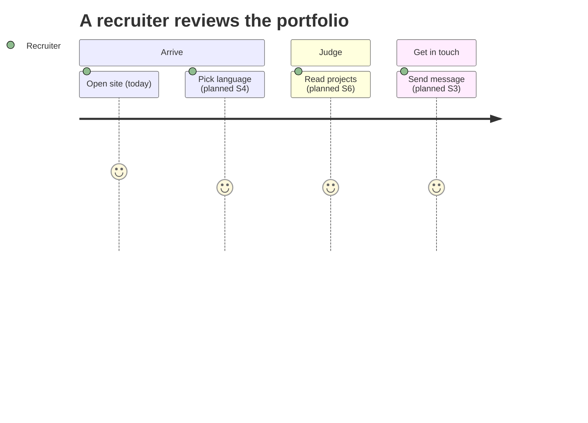
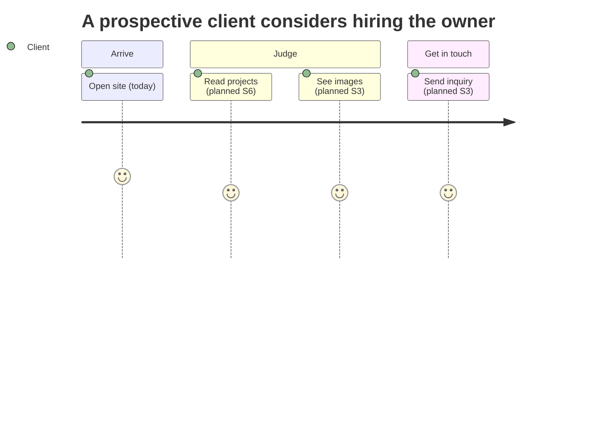
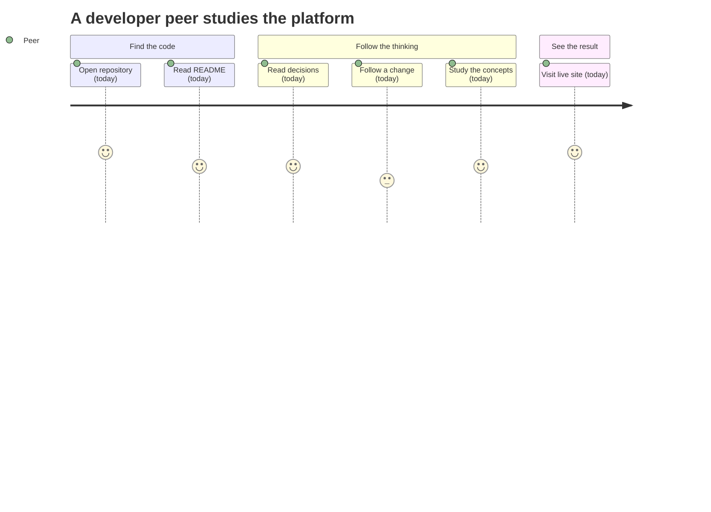
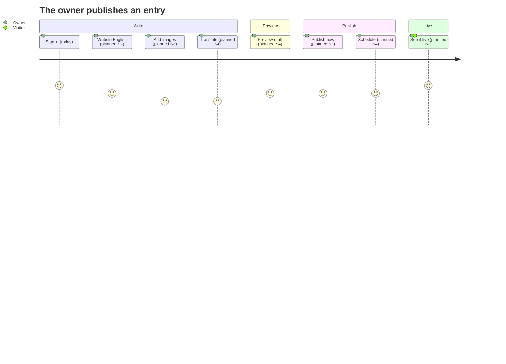

# User journeys

This document follows each kind of person through the platform, step by step.
It covers the three audiences of the public site and the owner who writes its
content. It shows what people do and which steps work today.

Other documents cover neighboring topics. [PRODUCT.md](PRODUCT.md) says who the
audiences are. [ARCHITECTURE.md](ARCHITECTURE.md) shows how the parts connect.
[DESIGN.md](DESIGN.md) describes how screens look. [ROADMAP.md](ROADMAP.md) says
when each capability arrives. [SYSTEM_DESIGN.md](SYSTEM_DESIGN.md) explains the
system design concepts behind the platform.

## How to read the journeys

- Each journey has a diagram and a table.
- Every step is marked **today** or **planned**. A planned step names the sprint
  that brings it, for example **planned (S2)**. The roadmap decides the sprint.
  Capability names in the tables are candidates. They become final when the
  change is proposed.
- The score in a diagram (1 to 5) is the experience the step is meant to give:
  5 means effortless, 1 means hard. A score is a design goal, not a
  measurement. It does not show whether the step exists. The step's name and
  the table show that.

## Recruiter or hiring manager

Goal: judge the owner's skills and experience, and decide whether to get in
touch.

| Step                                    | Status       | Capability                                           |
| --------------------------------------- | ------------ | ---------------------------------------------------- |
| Open the site                           | today        | `welcome` is live at `welcome.ycmcuenca.workers.dev` |
| Choose a language                       | planned (S4) | `content-localization`                               |
| Read the owner's projects               | planned (S6) | `portfolio-projects`                                 |
| Send a message through the contact form | planned (S3) | `contact-inbox`                                      |

## Prospective client

Goal: decide whether the owner can deliver work like the client's, and ask about
it.

| Step                                     | Status       | Capability                                           |
| ---------------------------------------- | ------------ | ---------------------------------------------------- |
| Open the site                            | today        | `welcome` is live at `welcome.ycmcuenca.workers.dev` |
| Read about past projects                 | planned (S6) | `portfolio-projects`                                 |
| Look at images of the work               | planned (S3) | `media-uploads`                                      |
| Send an inquiry through the contact form | planned (S3) | `contact-inbox`                                      |

## Developer peer

Goal: see how the platform is built and learn from it.

| Step                                     | Status | Capability                                                        |
| ---------------------------------------- | ------ | ----------------------------------------------------------------- |
| Open the repository on GitHub            | today  | The repository is public.                                         |
| Read the README and the documents        | today  | [README](../README.md) and the files in `docs/`.                  |
| Read the decisions and the roadmap       | today  | [DECISIONS.md](DECISIONS.md), [ROADMAP.md](ROADMAP.md).           |
| Follow a change from proposal to archive | today  | The `openspec/` directory.                                        |
| Study the concepts                       | today  | [SYSTEM_DESIGN.md](SYSTEM_DESIGN.md), the system design notebook. |
| Visit the live site                      | today  | `welcome` is live at `welcome.ycmcuenca.workers.dev`              |

## Owner: write, preview, publish, live

Goal: turn an idea into a page that visitors can read. The owner is the only
editor ([A1](DECISIONS.md#identity-and-access)).

| Step                              | Status       | Capability                        |
| --------------------------------- | ------------ | --------------------------------- |
| Sign in to `admin` through Access | today        | Cloudflare Access guards `admin`. |
| Write the entry in English        | planned (S2) | `admin-editor`, `content-model`   |
| Add images                        | planned (S3) | `media-uploads`                   |
| Fill in Filipino and Esperanto    | planned (S4) | `content-localization`            |
| Preview the draft inside `admin`  | planned (S4) | `draft-preview`                   |
| Publish now                       | planned (S2) | `revisions-publishing`            |
| Schedule a later time             | planned (S4) | `scheduled-publishing`            |
| See the page on the public site   | planned (S2) | `public-rendering`                |

English must be ready before any publish, and a locale that is not ready stays
hidden ([L3](DECISIONS.md#localization)). The first end-to-end publish happens
in S2. Images, other languages, preview and scheduling join it in S3 and S4.
